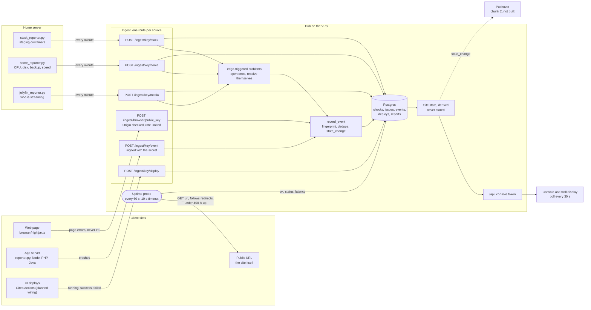
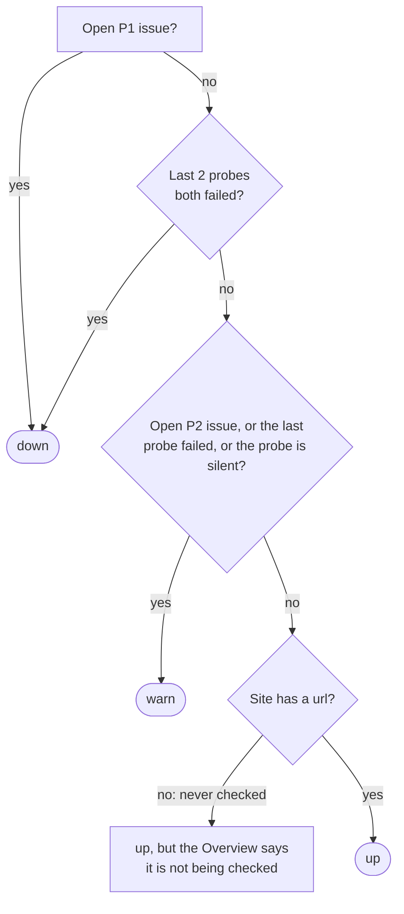
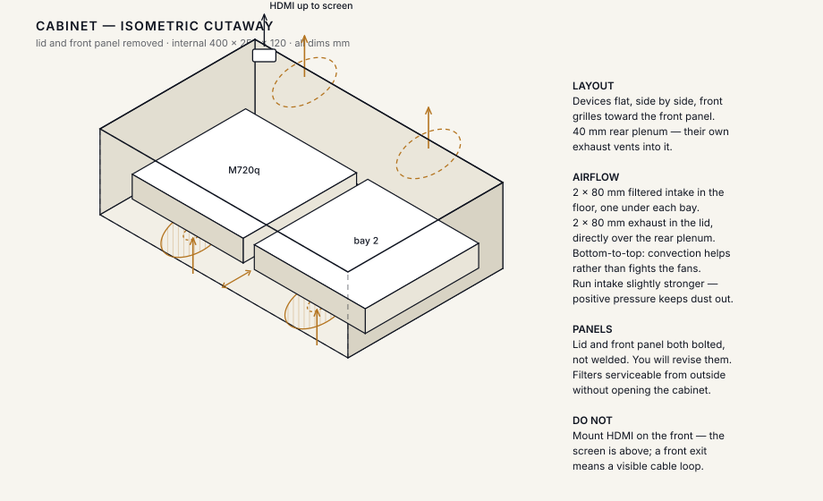
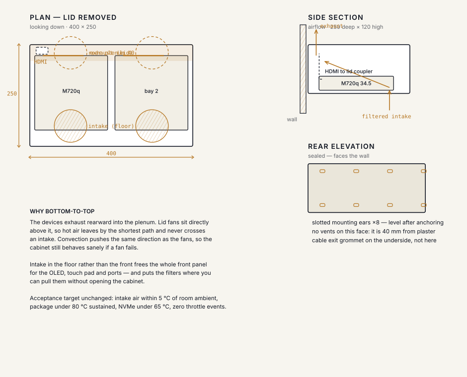
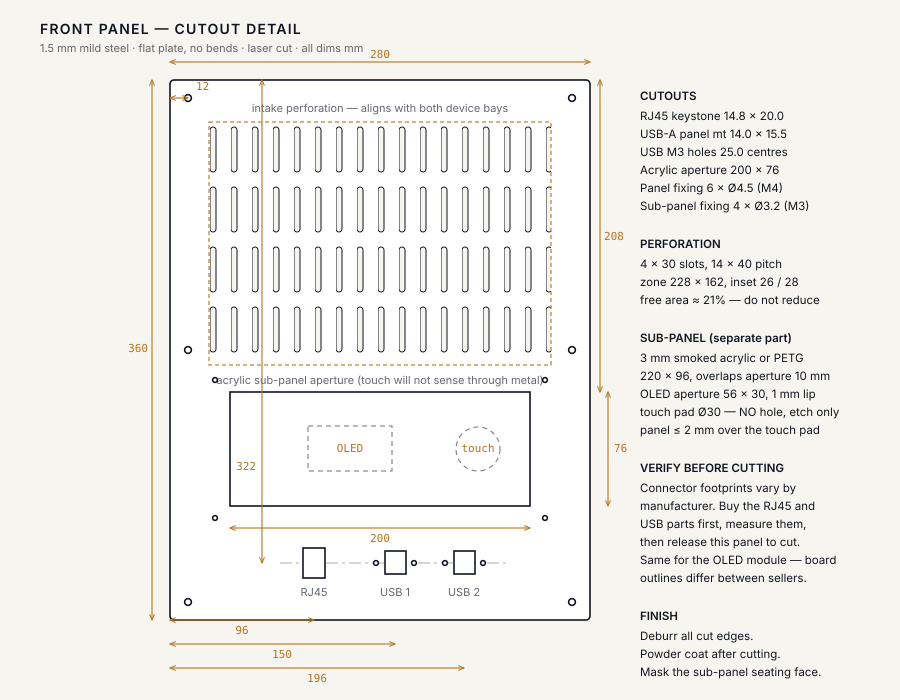
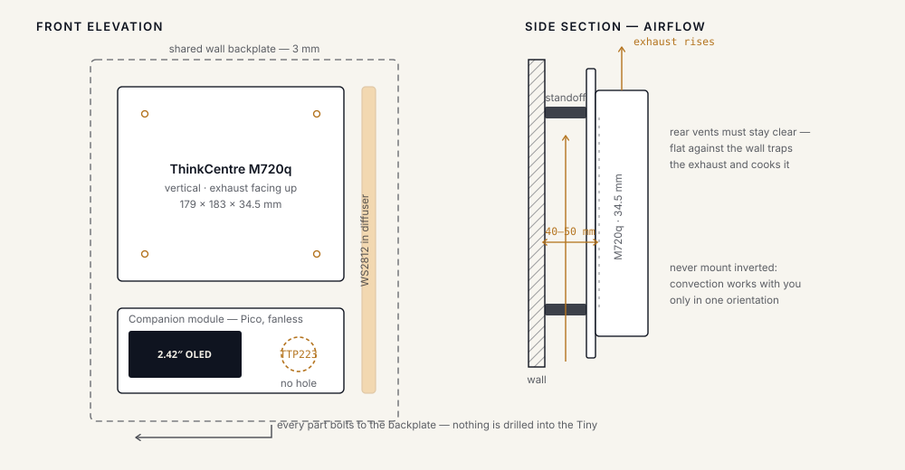

# Nightjar

**An incident hub for one developer who looks after client sites alongside a day job.**
Crashes, uptime failures and client requests go in. A small number of well-chosen phone notifications come out.

Named for a bird that only becomes active after dark, which is when this system will contact you.

---

## Table of contents

- [Status at a glance](#status-at-a-glance)
- [Why Nightjar exists](#why-nightjar-exists)
- [How it works](#how-it-works)
  - [How the uptime probe and the reporters fit together](#how-the-uptime-probe-and-the-reporters-fit-together)
- [The stack](#the-stack)
- [Core concepts](#core-concepts)
  - [Fingerprint](#fingerprint)
  - [state_change](#state_change)
  - [Issue status](#issue-status)
  - [Severity](#severity)
  - [Presence and routing](#presence-and-routing)
  - [Presence and NFC tags](#presence-and-nfc-tags)
- [The console](#the-console)
- [The wall monitor](#the-wall-monitor)
  - [What the monitor shows](#what-the-monitor-shows)
  - [Access tiers](#access-tiers)
  - [The cabinet](#the-cabinet)
  - [Airflow and thermals](#airflow-and-thermals)
  - [The Pico companion](#the-pico-companion)
  - [The dead-man's switch](#the-dead-mans-switch)
- [Where things run](#where-things-run)
- [Staging for client stacks](#staging-for-client-stacks)
  - [Seeing and controlling stacks](#seeing-and-controlling-stacks)
  - [Promotion readiness](#promotion-readiness)
  - [Capacity for ten stacks](#capacity-for-ten-stacks)
  - [Java apps](#java-apps)
- [Media ingest and archive (planned)](#media-ingest-and-archive-planned)
- [Client integration kit (planned)](#client-integration-kit-planned)
- [API reference](#api-reference)
- [Quick start](#quick-start)
  - [Configuration](#configuration)
  - [Prove it works](#prove-it-works)
  - [Tests and migrations](#tests-and-migrations)
- [Wiring up apps](#wiring-up-apps)
  - [Reporters by stack](#reporters-by-stack)
  - [Deploys](#deploys)
- [Deploying](#deploying)
- [Roadmap](#roadmap)
- [Known gaps](#known-gaps)
- [Conventions](#conventions)
- [Out of scope](#out-of-scope)
- [Documentation map](#documentation-map)
- [Brand](#brand)

---

## Status at a glance

| Piece | State |
|---|---|
| Ingest, fingerprinting, deduplication (chunk 1) | **Done and tested.** The same crash sent 200 times, with a different address and retry count each time, lands in **one** issue ([how](#fingerprint)) |
| Console: five tabs, uptime probe, incident actions, tickets, deploys, idle screen (chunk 3) | **Done.** Runs locally against a dev database |
| Alerting: alert policy, presence, Pushover, speaker (chunk 2) | **Not written.** Deferred until the Pushover licence, a domain and a VPS are paid for |
| Email intake and the 07:30 digest (chunk 4) | Not started |
| Media ingest and archive on a Raspberry Pi (side project) | **Planned, not built.** Research and design in [`docs/MEDIA-ARCHIVE.md`](docs/MEDIA-ARCHIVE.md) |
| Client integration kit: push checks, heartbeats, an npm CLI (chunk 4b, extended) | **Planned, not built.** Design in [`docs/CLIENT-INTEGRATION.md`](docs/CLIENT-INTEGRATION.md) |
| Wall display route, Pico companion, Gitea integration, client status page (chunks 5 to 8) | Designed, not built. The idle screen is the software precursor to the wall display |

> **Nightjar cannot yet interrupt you.** Until chunk 2 exists it deduplicates crashes and shows them
> in the console, but nothing buzzes your phone. Do not rely on it to catch a client outage.

---

## Why Nightjar exists

The operator has a day job. The scarce resource is not compute or storage, it is **attention at
inconvenient hours**. Every design decision is downstream of that.

1. **A notification that did not need to be sent is a bug**, as serious as a missed one. If the
   operator mutes the app, the system has failed completely.
2. **The phone is the product.** The console is for the morning triage pass, not for staring at.
3. **Nothing may suppress an alert.** Presence, fingerprint, the wall monitor, the speaker: each may
   *add* a channel or reveal detail. If all of them fail at once, Pushover still fires.

---

## How it works

```
client app crashes ─┐
uptime check fails  ─┼─→ ingest ─→ fingerprint ─→ alert policy ─┬─→ Pushover (P1 retries until acknowledged)
client emails       ─┘                                          └─→ daily digest
```

One FastAPI service, one Postgres, one React console. Everything else is a client of them.

What Nightjar deliberately does **not** do:

- **Exception capture.** Sentry or GlitchTip do it properly and forward in by webhook. Nightjar owns
  the deduplicated ticket store and the decision of whether to buzz the phone.
- **A native iOS app.** Pushover is the iOS app. Native means a developer account, APNs certificates
  and a Swift codebase, all to deliver a push notification.
- **Client logins.** Clients get an email address. A read-only status page comes later, when one
  asks twice.
- **Share a failure domain with what it watches.** It lives on a VPS, never on client
  infrastructure and never on the machine at home.

### How the uptime probe and the reporters fit together

Two kinds of source feed the hub, and they work in opposite directions. The **uptime probe pulls**: the hub
itself requests each site's `url`. Every **reporter pushes**: something that knows about a problem sends it in.
Neither can see everything, so each covers the other's blind spot.



**What each source can and cannot see.** This is why there are several, and why silence is treated as a fault:

| Source | Direction | Sees | Blind to |
|---|---|---|---|
| Uptime probe | Hub pulls | Whether the public URL answers, and how fast | Errors inside a working page, and anything on a private network |
| Server reporters (Python, Node, PHP, Java) | App pushes | Crashes with a stack trace | A dead app: it cannot report that it is dead |
| Browser reporter | Page pushes | JavaScript errors on real visitors' screens | A page that never loads |
| Stack, home and media reporters | Home server pushes | Container health, host health, streaming | A dead reporter, which is shown as `reporter silent` |

A dead app is the case the two halves cover together: the server reporter goes quiet, and the probe's next
request fails.

**How a site's state is decided.** It is derived from issues and probe results every time the console asks, and
never stored, so it cannot drift out of date:



A probe counts as silent when no check has arrived for the longer of 5 minutes or three intervals, and a silent
probe is never `up`. A staging site has no `url` the VPS can reach, so it is watched by its stack reporter
instead. See [`docs/KEYS.md`](docs/KEYS.md) for who is allowed to send what.

---

## The stack

| Layer | Technology | Role |
|---|---|---|
| Hub | FastAPI, Python 3.11+ | Ingest, fingerprinting, API, uptime probe |
| Database | PostgreSQL 16, async SQLAlchemy 2.0 | Issues, events, checks, tickets, deploys |
| Console | React 19, Vite 6 | Triage UI and the idle screen |
| Push | Pushover | iPhone delivery. Priority 2 retries every 60 s for 30 min until acknowledged |
| Ingress | Caddy 2 | TLS and the only public entry point |
| Packaging | Docker Compose | One `docker compose up` on the VPS |
| OS | Ubuntu Server LTS | Everywhere. Not Windows Server |

Around it, as separate services that feed Nightjar rather than parts of it:

| Service | Role |
|---|---|
| Sentry or GlitchTip | Optional richer error capture, forwarded by webhook |
| Uptime Kuma | A **second** probe from a different network, so "the client is down" is distinguishable from "my ISP is down" |
| Gitea and Gitea Actions | Self-hosted Git and CI. Deploy status reports back into Nightjar |
| Grafana | Reads the same Postgres for metrics. Not rebuilt inside Nightjar |
| Cloudflare Email Routing, Postmark or Mailgun | Inbound client email, parsed into tickets |
| healthchecks.io or Cronitor | External heartbeat: alerts you if Nightjar itself goes quiet |

Rejected on purpose, with reasons in [`docs/DECISIONS.md`](docs/DECISIONS.md): Datadog, Jenkins, a
native app, a client portal, running a mail server, hosting the hub at home.

---

## Core concepts

### Fingerprint

`hub/fingerprint.py` is the hash that turns 1,284 identical exceptions into one row.

It is built from `site_id` + exception type + **normalised** message + the innermost three frames as
`module:function`. Deliberately excluded:

- **Line numbers.** They shift when you edit anything above the bug. A fingerprint that changes on
  reformat is worthless.
- **Per-occurrence values.** IPs, UUIDs, emails, quoted strings and numbers become placeholders
  before hashing.

Both failure directions are real. Too loose and unrelated bugs merge, so you only hear about one.
Too tight and every occurrence is its own row.

**A worked example.** This is what the test sends, and what Nightjar makes of it. It is real output, not a mock-up:

| Occurrence | Message | After normalising | Fingerprint |
|---|---|---|---|
| #1 | `connection to server at "10.0.0.1" failed after 1 retries` | `connection to server at "<s>" failed after <n> retries` | `4b659855…` |
| #2 | `connection to server at "10.0.0.2" failed after 2 retries` | the same | `4b659855…` |
| #200 | `connection to server at "10.0.0.200" failed after 200 retries` | the same | `4b659855…` |

The quoted address becomes `"<s>"` and the retry count becomes `<n>`, so every occurrence reduces to the same
sentence and gets the same fingerprint. **That is what the "200" in these docs means.** It is only how many copies
the test script sends, enough to be convincing. It is not a limit of any kind.

Two things it must get right in the other direction, both checked:

- **Different bugs stay separate.** A different exception type, or the same crash on a different site, gets a
  different fingerprint.
- **Editing the file must not split one bug in two.** The same crash with its line numbers shifted by 30 keeps the
  same fingerprint.

### state_change

The seam between ingest and alerting. `POST /ingest/{key}/event` returns one of:

| Value | Meaning | Alerts? |
|---|---|---|
| `new` | first time this fingerprint has been seen | yes |
| `regression` | was resolved or snoozed, and is back | yes |
| `spike` | crossed `SPIKE_THRESHOLD` inside `SPIKE_WINDOW_MIN` | yes |
| `null` | known, already open, nothing changed | no |

**Alert on state change, not on events.** This one rule is the difference between a system that gets
used and one that gets muted in a week.

### Issue status

`open` · `resolved` · `muted` · `snoozed`

`muted` matters more than it looks. Some errors cannot be fixed today: a flaky third-party SDK, bots
hitting a dead route. Muted issues keep counting but never produce a `state_change`, including on
regression.

### Severity

Derived from the source, never chosen by hand.

| | Source | Night behaviour |
|---|---|---|
| **P1** | uptime failure, `fatal` | wakes the phone, retries until acknowledged |
| **P2** | `error`, rate spikes | normal push, quiet hours respected |
| **P3** | client email, `warning` | digest only |

### Presence and routing

Presence controls **which channels fire**, never **whether something alerts**. It is stored with an
expiry, not as a toggle, because a toggle desyncs permanently the first time a tap is missed.

An NFC tap sets `home` for 14 hours. On expiry, or with no record, the effective state is **`away`**,
the state where only the reliable channel is used. Always fail toward the reliable channel.

| | P1 | P2 | P3 |
|---|---|---|---|
| Home, daytime | push + speaker | push + soft chime | digest |
| Home, night | priority-2 push + speaker | push only | digest |
| Away | priority-2 push | push | digest |

Quiet hours are 22:00 to 07:00 Africa/Nairobi. P2 is silent at night regardless of presence, because
letting presence override quiet hours brings back exactly what quiet hours exist to solve.

The speaker is rate-limited from day one: one sound per issue per 15 minutes and a global hourly cap.
Without both, a spike machine-guns the speaker and it gets unplugged inside a week.

> Presence, routing and the speaker are chunk 2 and are **not implemented yet**.

### Presence and NFC tags

Presence is how Nightjar knows whether you are home, so it can add the speaker or hold a chime. It is
set by tapping an NFC tag with your iPhone.

> **Planned, not built.** This is chunk 2. Nothing below exists in the code yet.

**The tags.** Two NTAG213 stickers, because one tag maps to exactly one iOS Shortcuts automation:

| Tag | Where | Sets |
|---|---|---|
| `arriving` | inside the door frame | `home`, with a 14-hour expiry |
| `leaving` | by the keys | `away` |

Create one Shortcuts personal automation per tag and switch **off** "Ask Before Running" on both.
Otherwise every tap waits for a confirmation, and you will stop tapping.

**The endpoint.** Each automation calls the hub:

```
POST /presence
{"state": "home", "ttl_minutes": 840, "source": "nfc", "token": "<shared secret>"}
```

`source` is `nfc`, `geofence` or `manual`. `token` is how the hub knows the call is yours.

**Inputs, in order of trust:**

1. **NFC tap.** Explicit, so the most trusted.
2. **Geofence automation.** Catches a forgotten tap. It is flaky and can arrive late, which is harmless
   because every state expires.
3. **Manual override** in the console.

**Why it expires.** A stored toggle desyncs permanently the first time a tap is missed. An expiry lapses on
its own, and with no record the state is `away`, the state where only the reliable channel (the push) is
used. A missed tap therefore costs you a speaker announcement, never an alert.

**How to test it.** Tap out, then break a staging route and confirm the push **still arrives**. Presence
may add a channel. It must never be the reason a push does not fire.

---

## The console

A React app in [`console/`](console/), polling the hub every 30 seconds. No websockets. Dark only, in
neutral near-black.

The left sidebar has five tabs, with live count badges:

| Tab | What it does |
|---|---|
| **Overview** | Verdict line, odometer stats, a health card per production site (uptime ring, latency, 90-day ribbon), and a tile per area |
| **Incidents** | Open and all issues. A drawer with Acknowledge, Resolve, Mute, Snooze and Reopen, and an audit-trail log |
| **Requests** | Client requests (change, report, access) with overdue flagging. Logged by hand until email intake exists |
| **Deploys** | Production deploy history, reported by CI |
| **Staging** | Whether each staging site is **ready to promote**, and how it differs from production. A read-only view of each stack (state, memory against its limit, disk, CPU, restarts, services), host disk, builds in flight, uptime checks and staging deploys |

How the numbers are derived, so nothing is invented:

- **Site state is derived, never stored.** `down` is an open P1 or two failed probes in a row. `warn` is an
  open P2, one failed probe, or a probe that has gone quiet. Otherwise `up`. A silent probe is never `up`.
- **The 90-day ribbon** colours each day by its worst state. Days with no checks are grey, so "no data"
  never reads as "all good".
- **Errors rising** lists open issues whose event rate over the last 30 minutes is more than double the
  30 minutes before.
- **When the hub is unreachable** the console says so on every tab and never shows "All quiet".
  Silence must not read as all-clear.

Design references live in [`mockups/`](mockups/) as working HTML.

---

## The wall monitor

A dedicated monitor on the wall, driven by the ThinkCentre, showing the state of every site across the
room. It is a display, never a decision-maker: it may add detail, but it can never be the reason a push
does not fire.

### What the monitor shows

Two tiers of information, with the sensitive part hidden until you prove you are present:

- **Ambient (always on):** the verdict line, site names, severity, uptime and deploy status.
- **Revealed (fingerprint, 2 minutes):** incident titles, counts, ages and commit refs. It reverts by
  itself, never by a button, because you will walk away without pressing anything.

What is redacted is **detail, not names**. A site name tells a guest little, but
`postgresql://app@10.0.0.14:5432/sacco` in a stack trace tells them a great deal.

**What exists today** is the idle screen, the software precursor to the wall display. Open it at
`#/idle` in the console, or leave the console alone for 5 minutes and it starts by itself.

- Two production sites at a time as large check cards. It rotates to the next pair every 2 minutes.
- Active incidents, production deploys and staging deploys, plus a large clock.
- Incident titles and commit refs stay hidden until revealed.
- Ordinary mouse or keyboard input never dismisses it. Only reveal, then **Unlock console**, leaves it.
- The fingerprint is **simulated** with a labelled button until the reader hardware exists. Unlock only
  navigates and is not a security boundary (see [Known gaps](#known-gaps)).

**What is planned** (chunk 5): a `GET /wall` route that answers `404` to anything but the machine itself
(`127.0.0.1`), plus a single-use enrollment cookie. No token ever goes in the URL, because it lands in
browser history and access logs. It runs as a `cage` (Wayland kiosk) plus Chromium unit under systemd
with `Restart=always`, blanking disabled with `consoleblank=0`, and it caches the last good response so
an ISP blip shows stale data rather than an error.

### Access tiers

Three levels, each with its own threat model. Two are conveniences and only one is authentication.

| Tier | Surface | Gate | Shows |
|---|---|---|---|
| 1 Ambient | Wall monitor | none | Verdict, site names, uptime ribbons, percentages |
| 2 Limited | Wall monitor | R307 fingerprint, 2 minutes | Titles, counts, ages. Nothing diagnostic |
| 3 Full | Console | Passkey (WebAuthn) | Stack traces, variables, resolve, mute, snooze |

The R307 matches on the module and returns only a template ID, so the fingerprint itself never travels
or is stored. It is **convenience-grade**: fine for unblurring a screen in your own house, unacceptable
for anything that changes state.

### The cabinet

The hardware is a **Lenovo ThinkCentre M920q** (i7-8700T, 6 cores, 35 W, 8 GB plus a 16 GB SODIMM),
mounted vertically in a wall cabinet. It runs staging, Gitea, builds, backups, the second uptime probe,
and the wall display. It does **not** run Nightjar itself, which stays on the VPS.

The drawings below are in [`assets/`](assets/) and are generated by
[`tools/make_case_drawings.py`](tools/make_case_drawings.py).

**Isometric cutaway.** Two device bays side by side, a 40 mm rear plenum, filtered fans in the floor and
lid, and HDMI going up to the screen.



**Plan, side section and rear elevation.** The cabinet is 400 × 250 × 120 mm internally. Air enters
through the floor and leaves through the lid, so convection helps the fans rather than fighting them.



**Front panel cutouts.** A 1.5 mm steel plate, 280 × 360 mm, with an intake perforation, an acrylic
sub-panel and the RJ45 and USB cutouts.



**Wall mount.** Everything bolts to a shared 3 mm backplate on 40 to 50 mm standoffs. Nothing is drilled
into the ThinkCentre, and it is never mounted inverted.



> **These drawings predate several decisions. Treat them as reference, not as a cutting list.**
>
> - They show a **2.42" OLED and touch pad**. The OLED was later dropped in favour of the wall monitor
>   (decision #19).
> - They are dimensioned for an **M720q, 34.5 mm thick**. The chosen machine is the M920q at **37 mm**.
> - They show a perforated steel front. The later design splits the front into glass above and a solid
>   band below, with a roughly 35 mm plenum fed from below.
> - Connector footprints vary by manufacturer: buy the RJ45 and USB parts, measure them, then release the
>   panel to cut.

### Airflow and thermals

Lenovo's manual does not document airflow direction. It was read from chassis photos: **intake** is the
hex mesh at the bottom of the front bezel, **exhaust** is the rear slot column and the top face. So a glass
door cannot sit flush against the front, because that mesh is the intake.

That is still a strong hypothesis, not a measurement. **Run the tissue test on every face under load
before cutting steel.**

Acceptance targets for any enclosure:

| Measure | Target |
|---|---|
| Intake air vs room ambient | within 5 °C |
| CPU package, sustained load | under 80 °C |
| NVMe composite | under 65 °C |
| Throttle events over 30 minutes | zero |

Take an **open-air baseline before the cabinet exists**: it cannot be recovered afterwards.
[`client/thermal_probe.py`](client/thermal_probe.py) reports breaches into Nightjar as ordinary tickets.

### The Pico companion

A small Raspberry Pi Pico beside the monitor (chunk 6). Its jobs are a WS2812 status strip, the R307
fingerprint reader and a heartbeat watchdog. The RP2040 draws about 0.3 W, so it has no fan. The serial
adapter must be a no-op when nothing is attached.

Its watchdog is **deliberately dumb**: Nightjar pulses every 10 seconds, and after 60 seconds of silence
the strip blinks slow white on its own. It knows nothing about the sites. A smarter watchdog would need
to know what healthy looks like, and could therefore be wrong about it.

### The dead-man's switch

Both the Pushover call and the speaker are driven by the hub, so they share its fate. If the hub dies it
does not complain: it goes **silent**, and silence is indistinguishable from everything being fine.

Nightjar therefore pings an external heartbeat service every 5 minutes. If the pings stop, *they* alert
your phone. This is the only mechanism that turns silence back into a signal, and it is the reason
self-hosting is defensible at all.

---

## Where things run

Two machines, split by consequence. **Nightjar lives on the VPS, permanently.** That is not a stopgap.

| VPS (Ubuntu LTS, 2 vCPU / 4 GB) | ThinkCentre M920q (Ubuntu LTS, headless) |
|---|---|
| Nightjar hub | Staging environments, one stack per client |
| Postgres | Gitea and Gitea Actions |
| Caddy, the only ingress | Grafana |
| External heartbeat ping | Uptime Kuma, the **second** probe |
| | Backup target, pulling nightly from the VPS |
| | Chromium kiosk driving the wall monitor |

The rule: **Nightjar must be more reliable than the things it watches.** A watchdog at home inherits the
house's ISP, power and maintenance mistakes, and when it dies it goes silent. The wall monitor runs *on*
the ThinkCentre but fetches from the VPS over HTTPS, so switching the screen off or losing home internet
does not affect alerting at all.

---

## Staging for client stacks

> **Partly built.** The read-only stack view, the stack reporter and the Dockge setup files exist
> (see [Seeing and controlling stacks](#seeing-and-controlling-stacks)). Caddy routing, the per-client
> layout and Gitea Actions deploys are still planned, and every capacity number is an **estimate**. Deploy
> two or three real stacks, run `docker stats` for a day, and multiply.

Nightjar's own backend (FastAPI and Postgres) does not constrain what clients run. It receives plain HTTP,
so a client on PHP, Node, Python or Java is fine. What hosts staging is the ThinkCentre, using **Docker
Compose with Caddy in front**, which hides the language differences behind containers.

**The layout.**

- **One Compose project per client**, for example `/srv/staging/<client>/` and
  `docker compose -p <client> up -d --build`. Each has its own network and its own database.
- **Only Caddy joins a shared network.** No stack publishes a host port.
- **Routing by subdomain.** `clientname.staging.yourdomain` reaches that client's container, with one
  wildcard DNS record covering all of them.
- **Staging stays off the public internet**, behind Tailscale or basic auth. It holds real client data and
  should not be indexed.
- **Resource limits on every service.** Set `mem_limit` and `cpus`, so one runaway app is killed before it
  takes the machine down. Add swap (8 GB or zram) as a safety net, not something to rely on.

**The deploy path.** A Gitea Actions runner on the ThinkCentre deploys on a push to `develop`, then reports
to Nightjar with the deploy webhook (`running`, then `success` or `failed`). Each staging stack is a site
with `env=staging` and a `url`, so it gets the same uptime checks and appears on the Staging tab.

**Reporters.** [`client/reporter.py`](client/reporter.py) covers FastAPI, and there is one dependency-free file
each for [Node](client/node/nightjar.ts), [PHP](client/php/Nightjar.php), [Java](client/java/Nightjar.java) and
[web pages](client/browser/nightjar.ts). They share one contract, described in
[`docs/REPORTERS.md`](docs/REPORTERS.md). The uptime probe and deploy reports work for any language.

### Seeing and controlling stacks

These are two jobs, kept apart on purpose:

| Job | Where | How |
|---|---|---|
| **See** the stacks | The console's Staging tab | [`client/stack_reporter.py`](client/stack_reporter.py) on the ThinkCentre *pushes* each stack's state to the hub |
| **Control** them (start, stop, logs) | [Dockge](https://github.com/louislam/dockge) on the ThinkCentre | Reached over Tailscale, never the public internet |

The hub is on the VPS and staging is at home, so the hub cannot see that machine's Docker, and must not be
given it. The reporter reads `docker ps` and `docker stats` for the Compose projects you list, and posts
them signed like every other ingest. Nightjar never controls a container.

**A stop is not a crash.** Docker Desktop stopping its VM, a reboot and `docker compose stop` leave containers
exited with 137, 143 or 255, and none of those is a failure, so they read `stopped`. A real crash code (1, 2,
139 and so on) is `unhealthy` for 15 minutes (`NIGHTJAR_CRASH_WINDOW_MIN`) and simply `stopped` after that, and
a container killed for running out of memory always counts. Every non-clean state carries a note under the
service, such as "exited 137 (stopped or killed), 30 days ago", so nothing is hidden.

The Staging tab shows, per stack: running, degraded or stopped; memory against its limit; CPU; a memory
trend; and each service's state. It **warns when a running stack has no memory limit**, and shows a stack
whose reporter has gone quiet as `reporter silent`, never as healthy. A **Manage stacks** button links to
Dockge when `VITE_STACK_CONTROL_URL` is set.

Setup is in [`deploy/staging/`](deploy/staging/) and the staging section of [`DEPLOY.md`](DEPLOY.md): a
Dockge compose file bound to the Tailscale address only, a systemd timer for the reporter, and a client
stack template with a `mem_limit` on every service.

### Promotion readiness

Each staging site gets a card answering "can this go to production, and what would change?"

**Ready to promote** needs all of:

- the latest deploy **succeeded** (a failed or unfinished one blocks, even if an older one succeeded)
- a live health check with **99% or better uptime over 24 hours**
- **no open P1 or P2** on the staging site
- no stack that is **silent, degraded or restarting repeatedly**

Any blocker wins, and the card lists each one. Otherwise the card compares the last successful ref on staging
and production: **ahead** (ready), **in sync** ("nothing to promote"), or **behind** (production was deployed
after staging, so promoting would go backwards).

**Naming convention.** A staging site is paired with its production site **by name**: `<production>-staging`
belongs to `<production>`, so `agrovet-api-staging` is compared with `agrovet-api`. It is a convention and not a
database column, which keeps sites independent. An unpaired site is still checked, it just cannot be compared.

The tab also watches the machine itself:

- **Host disk free**, amber under 20% and red under 10%. Disk was the unknown in the capacity plan.
- **Builds running**, warning when more than one is in flight at once. That is the "one build at a time" rule.
  A report still "running" after an hour is treated as a job that never finished, not as a live build.
- **Restart loops.** A container restarting again and again still reads as running between crashes, so three or
  more restarts in ten minutes is flagged separately.

**Stack problems become issues.** A stack going degraded, entering a restart loop, nearing its memory limit
(85%), or the host disk falling under 10% free opens an issue through the normal pipeline. It is
**edge-triggered**: only a problem that has *just started* opens an event. One per one-minute report would be
1,440 a day and would trip the spike detector, which is exactly the noise this project exists to prevent.
Degraded and restart loops are P2. Memory is a P3 warning, so it can never wake anyone. Sending them to your
phone waits for chunk 2.

**They resolve themselves.** Once a problem has been gone for **10 minutes of reports in a row**
(`STACK_HEALTHY_MIN`), its issue is resolved automatically. The rule is strict on purpose, because a resolved
issue that relapses counts as a regression, and a flapping stack must not resolve and reopen all day:

- the problem must be absent from every report in the window, with history reaching back far enough to
  vouch for all of it
- a gap in the reports means nothing resolves, since a silent reporter is not evidence of health
- only **open** issues are touched: muted and snoozed stay as they are, and one you resolved yourself is left alone
- the incident log says it was automatic: "Resolved automatically: agrovet has been healthy for 10 minutes"

**Decommissioned stacks.** A stack that stops reporting stays visible as `reporter silent`, because silence looks
like health, and it blocks promotion. Use **Remove** on the card once you know it was retired. The hub refuses
unless the stack really is silent.

### Capacity for ten stacks

The ThinkCentre has 6 cores and 24 GB of RAM (8 GB plus the planned 16 GB module). Roughly 7 GB goes to
Gitea, the runner, Grafana, Uptime Kuma and the wall-display browser. That leaves about 15 to 17 GB.

| Stack | Estimated idle RAM |
|---|---|
| PHP or WordPress (app and web server) | 150 to 300 MB |
| Node app | 150 to 400 MB |
| Its database | 200 to 500 MB |
| **Typical stack total** | **0.5 to 1 GB** |

Ten typical stacks come to about 8 GB, which fits with headroom. What can break it:

- **Builds, not running stacks.** A `composer install`, `npm ci` or Docker build can briefly want 1 to 3 GB
  and every core. Run **one build at a time** (runner concurrency of 1). That also protects the thermal
  target of CPU under 80 °C.
- **Disk.** Each stack is roughly 2 to 4 GB of images and data, plus build cache. Schedule
  `docker system prune`, and check the SSD size, which is not recorded anywhere yet.
- **One heavy client.** It can use as much as five light stacks.

Ways to reduce pressure:

1. Stop idle stacks after a day or so and start them on demand. Ten registered stacks may mean only four or
   five running at once.
2. Share one Postgres server with a database and user per client, instead of one server per stack. This is
   lighter but less isolated, so start with one per stack and consolidate only if RAM runs out.

Past about ten stacks, or with several heavy clients, one machine is the bottleneck. A second box or a small
VPS is cheaper than clever tuning.

### Java apps

Java is the heaviest common stack for this machine. A JVM reserves memory up front, so it uses roughly the
same RAM whether or not anyone is using the app.

| | Typical stack | Java (Spring Boot and similar) |
|---|---|---|
| Idle RAM, app only | 150 to 400 MB | about 400 to 800 MB |
| With its database | 0.5 to 1 GB | about 1 to 1.5 GB |
| Build | brief spike | slow, can want 2 to 4 GB and all cores |
| Start time | seconds | 10 to 60 seconds |

A mixed ten, say four Java stacks at 1.3 GB and six lighter ones at 0.8 GB, is about 10 GB. With the
infrastructure and a build spike that is around 20 GB of 24 GB: tight but workable. It stops working if most
of the ten are Java, or if one is very heavy. Elasticsearch, Kafka and large legacy WAR apps each need 1 to
2 GB or more alone, and belong on a separate small VPS.

Rules for Java stacks:

1. **Set the heap explicitly.** Use `-XX:MaxRAMPercentage=70` (or `-Xmx`) alongside a container `mem_limit`.
   Without a matching limit a JVM can grow until the container is killed.
2. **Build in CI, not on the staging box.** Deploy the finished image. A Maven build on the ThinkCentre is
   the worst case for RAM and heat.
3. **Keep Java stacks running.** Slow startup makes auto-stop unpleasant, so stop the light stacks when idle
   and leave the Java ones on.
4. **Cache dependencies** (`~/.m2` or `~/.gradle`) in a volume so builds are faster.

---

## Media ingest and archive (planned)

> **Planned side project, not built.** Nothing here is in the code, and it is not on the critical path. The
> research and full design are in [`docs/MEDIA-ARCHIVE.md`](docs/MEDIA-ARCHIVE.md). The Pico companion is
> unchanged and stays paused.

You are getting into film and production, and a Raspberry Pi already works as a camera media upload device
(a place to drop a file). This is the plan for turning that into an archive. The media Pis are **a separate system**: they share no
machine, disk or CI with staging, and Nightjar only watches them.

**How big the footage is.** Apple's published ProRes rates: one hour of UHD ProRes 422 HQ at 24p is **318 GB**
(707 Mb/s), and at 30p it is 398 GB. That is about 12 hours on a 4 TB drive, and a two-hour shoot is roughly
636 GB. Your camera's native format may be much smaller or larger, so its real bitrate comes first. On gigabit
Ethernet, one hour of that footage takes about 53 minutes to move at 100 MB/s.

**On location, two storage tiers.** Cards fill on site and the next shot needs an empty one, so clearing the card and uploading are treated as two separate jobs. Footage is copied to a **local SSD** on a field Pi, verified by read-back, and only then may the card be cleared. It is uploaded to the **archive at home** (the hard disk) only once the local copy is confirmed, and the local copy is freed only once the remote copy verifies. LTE cannot carry a RAW shoot day (roughly 212 to 477 GB per hour of ProRes RAW, against a few to a few hundred Mbps of uplink), so over LTE only **chosen selects or proxies** go up, and the full footage travels on the drive. A 256 GB card takes about 43 minutes to a hard disk and about 11 to an SSD before verification (estimates), which is why the local tier is an SSD. Details and the open questions are in [`docs/MEDIA-ARCHIVE.md`](docs/MEDIA-ARCHIVE.md#on-location-two-storage-tiers).

**What Nightjar would do:** watch, not manage. A Media tab for uploads, archive disk and verification; issues for
a low disk, a checksum mismatch or a silent Pi (P2 or P3, **never P1**, so media cannot wake you); and the same
pattern as staging stacks, where a reporter pushes in and silence shows as `reporter silent`. It would never store,
transcode or browse footage, because tools for that exist.

Six questions block the design, starting with which Raspberry Pi models you have. They are listed in the design doc.

---

## Client integration kit (planned)

> **Planned, not built.** Nothing here is in the code. This extends chunk 4b (fleet onboarding). The full plan
> is in [`docs/CLIENT-INTEGRATION.md`](docs/CLIENT-INTEGRATION.md).

Two limits of the current uptime probe, and the pieces planned to fix them:

| Limit | Planned fix |
|---|---|
| **A private app cannot be probed from the VPS.** | A **push check**: a small job inside the client's network fetches the private URL and pushes the result, so the app still gets an uptime ring, latency and ribbon. And a **heartbeat**: the app or a cron job pings Nightjar, and the alert fires when the pings **stop**, which also catches a dead host. Both need only outbound traffic. |
| **A site is not monitored until its `url` is set by hand.** | A warning on the Overview for any site with no monitoring, an **add-site form** in the console, and `nightjar add-site` in the CLI. |

**What works today with no new code:** a cron job on the client's host checks the private URL and, on failure,
posts a `fatal` event to `/ingest/{key}/event`. Its limit is that if the whole host dies, nothing is sent.

**Can it go on npm? Yes, as `@<scope>/nightjar`.** The kit is a `nightjar` CLI (`deploy`, `heartbeat`, `check`,
`add-site`), a Node error reporter, the existing reporter packaged for PyPI, and a dependency-free `nightjar.sh` for
hosts without Node or Python. What was checked:

- **Plain `nightjar` is taken** on npm by an unrelated library, so the package must be scoped. Whether `@brandon` is
  yours is **unverified**: choose and create the scope first, ideally a free organisation.
- **`nightjar-reporter` is free** on PyPI.
- **Publish from GitHub Actions**, not the Gitea runner: npm's trusted publishing supports GitHub-hosted runners and
  not self-hosted ones, and gives signed provenance with no long-lived token.

**The risk to take seriously:** the package runs with a client's site secret, so a compromised release would expose
every client that installed it. The plan is zero runtime dependencies, trusted publishing with provenance, clients
pinning an exact version with a lockfile, ingest-only credentials (a site key cannot read the console or mute an issue,
and the console token never goes in a client's CI), and a vendorable `nightjar.sh` for anyone who would rather read one
short script than trust a package.

**Order:** the small hub pieces and `nightjar.sh` first, since they are useful before there are four apps. The npm and
PyPI packages wait for three or four apps, as decision #20 already says. Five open questions are in the design doc,
starting with which stacks your clients run.

---

## API reference

Ingest, called by client apps and CI. Authenticated by the per-site key in the URL. With
`VERIFY_SIGNATURES=true`, also by an `X-Hub-Signature: sha256=<hmac-sha256 of the raw body>` header.

| Method and path | Purpose |
|---|---|
| `POST /ingest/{key}/event` | Report a crash. Returns `issue_id`, `fingerprint`, `event_count`, `severity`, `state_change` |
| `POST /ingest/{key}/deploy` | Report a deploy: `{"ref": "main@1f9c4a2", "status": "running \| success \| failed"}` |
| `POST /ingest/{key}/stack` | Report a staging stack's state. Sent by `client/stack_reporter.py`, not by hand |
| `POST /ingest/browser/{public_key}` | Report an error from a web page. No signature: the key is public, so it is Origin-checked, rate limited and capped. See [`docs/KEYS.md`](docs/KEYS.md) |

Console feeds, read-only:

| Method and path | Purpose |
|---|---|
| `GET /api/sites/health` | Per-site state, uptime, latency, latency series and 90-day ribbon |
| `GET /api/issues?status=open\|all` | Issues, open first, then by severity and recency |
| `GET /api/errors/rising` | Open issues whose event rate is climbing |
| `GET /api/issues/{id}/log` | The audit trail for one issue |
| `GET /api/tickets?status=open\|closed\|all` | Client requests |
| `GET /api/deploys?env=production\|staging\|all` | Deploy history |
| `GET /api/stacks` | Staging stacks as last reported: state, memory and limit, CPU, services, and whether the reporter has gone silent |
| `GET /healthz` | Liveness |

**Everything under `/api` requires the console token**, either as the session cookie that login sets or as
`Authorization: Bearer <token>` for scripts. `/ingest` keeps its per-site key and signature, and `/healthz` is open.
With `CONSOLE_TOKEN` unset, auth is off (local development only), and the hub refuses to start that way when
`VERIFY_SIGNATURES` is on.

| Method and path | Purpose |
|---|---|
| `GET /api/auth/status` | `{required, authenticated}`. The console asks this to decide whether to show the login |
| `POST /api/auth/login` | `{"token": "..."}`. Sets an HttpOnly, SameSite=Strict session cookie. 10 failures a minute locks out |
| `POST /api/auth/logout` | Ends the session |

Console writes:

| Method and path | Purpose |
|---|---|
| `POST /api/issues/{id}/actions` | `{"action": "ack \| resolve \| mute \| snooze \| reopen", "hours": 24}` |
| `POST /api/tickets` | Log a client request |
| `PATCH /api/tickets/{id}` | Close or reopen one |
| `DELETE /api/stacks?site=&stack=` | Forget a decommissioned stack. Refused (409) unless its reporter is silent |

Planned: `POST /pushover/ack` and `POST /presence` (chunk 2), `POST /ingest/email` (chunk 4), `GET /wall`
(chunk 5), `POST /ingest/gitea` (chunk 7).

---

## Quick start

Requires Python 3.11+, Node 20+ and Docker. No paid service is needed to run it locally.

```bash
git clone https://github.com/em-brandon/Nightjar.git && cd Nightjar

python -m venv .venv && source .venv/bin/activate    # Windows: .venv\Scripts\activate
pip install -r requirements.txt
cp .env.example .env

docker compose -f docker-compose.dev.yml up -d db    # Postgres on 127.0.0.1:5433
python seed.py                                       # prints ingest_key and ingest_secret
uvicorn hub.main:app --reload                        # http://localhost:8000
```

In a second terminal:

```bash
cd console && npm install && npm run dev             # http://localhost:5173
npm test                                             # the promotion-readiness rules
```

Vite proxies `/api` to the hub, so there is no CORS to configure. The dev database is a **separate
compose file** on purpose: `docker-compose.yml` is the production file and never publishes the database
port. The dev one publishes `5433`, not `5432`, so it cannot collide with a Postgres already installed on
the machine.

To give a site uptime checks, set its URL. It is probed every minute and appears on the Overview:

```bash
docker compose -f docker-compose.dev.yml exec db \
  psql -U hub -d nightjar -c "UPDATE sites SET url = 'https://client.example/healthz' WHERE name = 'demo-api';"
```

### Configuration

| Variable | Default | Purpose |
|---|---|---|
| `DATABASE_URL` | `.env.example` sets `...@localhost:5433/nightjar` | Database connection. The built-in fallback is port 5432 |
| `VERIFY_SIGNATURES` | `false` | HMAC check on ingest. Off in dev, **on in prod** |
| `SPIKE_THRESHOLD` | `50` | Events inside the window that count as a spike |
| `SPIKE_WINDOW_MIN` | `10` | The window, in minutes |
| `PROBE_ENABLED` | `true` | Run the uptime checker |
| `PROBE_INTERVAL_S` | `60` | Seconds between probe rounds |
| `PROBE_TIMEOUT_S` | `10` | Per-request timeout |
| `CONSOLE_TOKEN` | empty | Guards the console and `/api`. Empty is open, for local development only. **Required in production**: the hub refuses to start without it, or with one under 16 characters |
| `STACK_HEALTHY_MIN` | `10` | Minutes a stack problem must stay gone before its issue resolves itself |

### Prove it works

```bash
./test_ingest.sh <ingest_key> [count]        # count defaults to 200
```

It sends 200 copies of one crash, each with a different address and retry count, and **explains itself as it
goes**: it shows the sample messages, then counts how many different issues the responses came back under.
**`PASS` means exactly one** (exit code 0). Anything else prints `FAIL` with the reason (exit code 1): the wrong
key, a hub that is down, a hub that wants signed requests, or, if the fingerprint were broken, how many separate
issues the crashes landed in. Open the console afterwards: one site in `warn` and one open issue.

Against a production hub, which checks signatures, give it the site's secret so it signs each request the way a
real reporter does:

```bash
NIGHTJAR_URL=https://nightjar.example.co.ke NIGHTJAR_SECRET=<ingest_secret> ./test_ingest.sh <ingest_key>
```

---

### Tests and migrations

```bash
python -m unittest discover -s tests -v    # migrations (needs the dev database up), auth, stack policy
python -m unittest discover -s client -v   # the stack reporter's stop-versus-crash rules
cd console && npm test                     # promotion readiness, and a guard against CSS class-name collisions
```

The schema is managed by **Alembic** and migrates automatically every time the hub starts, so a new column no
longer needs a hand-run `ALTER TABLE`. To change it:

```bash
# edit hub/models.py, then
python -m alembic revision --autogenerate -m "what changed"
# read the file it wrote, then commit it
python -m alembic check    # fails if the models and the migrations disagree
```

A database created before migrations existed is **adopted** on first start, but only if it matches the models.
If it has drifted, the hub refuses to start and says so, rather than declaring a wrong schema correct.

## Wiring up apps

### Reporters by stack

A **reporter** is a small file inside a client's app that sends its errors to the hub. There is one for each stack. Each
is a single file with no dependencies that you copy in, and all of them follow the rule in `client/reporter.py`: **it must
never break the app it reports on.** Every path is wrapped and swallowed, a send has a short timeout and no retry, and
nothing can queue without a limit. Details, the shared wire format and the levels are in
[`docs/REPORTERS.md`](docs/REPORTERS.md). Which key each one holds is in [`docs/KEYS.md`](docs/KEYS.md).

| Stack | Reporter | Credential | Install |
|---|---|---|---|
| Python: FastAPI | [`client/reporter.py`](client/reporter.py) | ingest secret | `install_reporter(app, url, secret)` |
| Python: Django | a middleware snippet in [`INTEGRATE.md`](INTEGRATE.md) | ingest secret | add to `MIDDLEWARE` |
| Node: Express | [`client/node/nightjar.ts`](client/node/nightjar.ts) | ingest secret | `init()` and one middleware |
| PHP: plain, Laravel, WordPress | [`client/php/Nightjar.php`](client/php/Nightjar.php) | ingest secret | `Reporter::install([...])` |
| Java: Spring and others | [`client/java/Nightjar.java`](client/java/Nightjar.java) | ingest secret | `Nightjar.init()` |
| Web pages: React, Astro, Vite, plain JS | [`client/browser/nightjar.ts`](client/browser/nightjar.ts) | **public key, no secret** | `init({ hub, key })` |
| Static site with no code | none needed | none | the uptime probe covers it |

The first five run on a **server** and hold the site's ingest secret, so they never go in a web page. A page cannot keep
a secret, so it uses its own route and its own key.

#### Python: FastAPI and Django

```python
from reporter import install_reporter
install_reporter(app, url="https://nightjar.example.co.ke/ingest/<key>/event", secret=os.environ["NIGHTJAR_SECRET"])
```

This is the original reporter. It takes the full event URL; the others take the hub's address and the key separately.
Unhandled errors are reported and the visitor still gets a clean 500. Django uses a middleware, shown in `INTEGRATE.md`.

#### Node: Express

```ts
import { init, expressErrorHandler, installProcessHandlers } from "./nightjar";

init();                          // reads NIGHTJAR_URL, NIGHTJAR_KEY, NIGHTJAR_SECRET
installProcessHandlers();        // report a crash that kills the process
// ... your routes ...
app.use(expressErrorHandler());  // after the routes; it reports, then calls next(err)
```

- Your own error handler still sends the response, and a crash still exits with code 1.
- A process crash is the one thing reported as `fatal` (P1), because the whole service is gone.
- Only Express has a ready-made middleware. For Fastify, Koa or anything else, call `captureException(err)` from that
  framework's error hook.
- Node 18 or newer. It runs directly on Node 22.18 and up; on older Node, compile it with `tsc` or `esbuild`.

#### PHP: plain PHP, Laravel and WordPress

```php
require __DIR__ . '/Nightjar.php';
\Nightjar\Reporter::install(['hub' => 'https://nightjar.example.co.ke', 'key' => '<ingest key>', 'secret' => '<ingest secret>']);
```

- PHP 7.4 or newer, using `curl` if it is there and plain streams if not.
- Reports are sent when the request ends, and under PHP-FPM after the response has gone out, so a slow hub costs the
  visitor nothing. After a failed send, nothing is sent for 30 seconds.
- **Pass the options in code.** PHP-FPM clears environment variables by default, so `NIGHTJAR_*` may be empty there.
- **Call `install()` after the app sets its own exception handler.** PHP keeps only the last one.
- **Laravel:** report from `$exceptions->report(...)` in `bootstrap/app.php`. **WordPress:** a must-use plugin. Both
  snippets are in `docs/REPORTERS.md` and **have not been run against a real install**, so try them on staging first.

#### Java: Spring and others

```java
Nightjar.init();                    // reads NIGHTJAR_URL, NIGHTJAR_KEY, NIGHTJAR_SECRET
Nightjar.installUncaughtHandler();  // report a thread that dies
Nightjar.captureException(e);       // an exception you caught yourself
```

- Java 11 or newer, JDK only. Reports go through one daemon thread behind a queue of five, so the JVM exits freely and a
  hung hub costs the app nothing.
- **A wrapped exception is reported as its root cause**, with the wrappers listed alongside, because a wrapper's own stack
  trace only points at the wrapping.
- **Names that change on every start** (CGLIB proxies, lambdas) are normalised, so a restart does not make every error new.
- **Spring:** a `HandlerExceptionResolver` that reports and then declines to handle the exception is in `docs/REPORTERS.md`.
  It **has not been run against a real Spring application**.

#### Web pages: React, Astro, Vite and plain JavaScript

```ts
import { init, captureException } from "./nightjar";
init({ hub: "https://nightjar.example.co.ke", key: "<the site's public key>", release: "v1.4.2" });
```

First list the pages allowed to report, which makes the public key:
`PATCH /api/sites/<id>` with `{"allowed_origins": ["https://example.co.ke", "https://www.example.co.ke"]}`.

- **The key is public by design.** It can only report errors for its own site, only from the listed origins, and never as
  P1. The Origin check stops other websites but not `curl`, so the hub also rate limits and caps the number of new
  issues a site can open from browsers in an hour.
- **Quiet by default.** Uncaught page errors go as warnings, which reach the morning digest and never wake you. Escalate
  on purpose with `captureException(err, "error")` for something like a failed checkout.
- It drops browser quirks, extension errors and errors that happened only in other people's scripts, and sends the same
  error at most once in ten minutes.

#### Which reporter for which app

| Client app | Server errors | Page errors |
|---|---|---|
| StoryPro Film (Astro, FastAPI backend) | Python reporter | browser reporter |
| Kubasu Motors (React, FastAPI backend) | Python reporter | browser reporter |
| Bird Box Systems (vanilla TypeScript and React, no backend) | none, there is no server | browser reporter |

If the Astro site renders on a server rather than being built to static files, its server-side errors can use the Node
reporter as well.

#### Testing the reporters

`python -m unittest tests.test_server_reporters -v` runs every server reporter for real against the real hub with signature
checking on, and crashes real PHP processes against a local server. A runtime that is not installed is skipped by name.
Each reporter also has its own suite: `node client/node/nightjar.test.mjs`, `php client/php/test.php`, and the Java test
described in `docs/REPORTERS.md`.

### Deploys

Add one step to the end of a pipeline, using the site's ingest key:

```bash
curl -s -X POST "$NIGHTJAR_URL/ingest/$NIGHTJAR_KEY/deploy" \
  -H "Content-Type: application/json" \
  -d '{"ref": "'"$GITHUB_REF_NAME@$GITHUB_SHA"'", "status": "success"}'
```

Send `running` when a deploy starts, then `success` or `failed`. A staging environment is just a site with
`env` set to `staging`, so it uses its own key. See [`INTEGRATE.md`](INTEGRATE.md) for Sentry, uptime
monitors and Gitea.

---

## Deploying

Nightjar deploys to a single VPS with Docker Compose. [`DEPLOY.md`](DEPLOY.md) has the full walkthrough:
picking a provider, DNS, [`deploy/bootstrap.sh`](deploy/bootstrap.sh) for a hardened Ubuntu box,
`docker compose up -d --build`, and [`deploy/backup.sh`](deploy/backup.sh) for nightly dumps.

It is **not** configured for Vercel or similar serverless hosts. The hub is a long-running service with a
background uptime probe, which serverless platforms freeze between requests.

> **Do not deploy the current stack to the public internet as-is.** See the first two items below.

---

## Roadmap

| Chunk | What | State |
|---|---|---|
| 1 | Models, fingerprinting, ingest, HMAC, reporter, dedupe test | Done |
| 3 | React console, uptime probe, incident actions, tickets, deploys, idle screen | Done |
| 2 | Alert policy, presence, Pushover, speaker | **Next, blocked on cost.** The whole point of the project |
| 4 | Email intake and the 07:30 digest | Not started |
| 4b | Fleet onboarding: published reporters and an `add-site` CLI, extended into a client integration kit (push checks, heartbeats, an npm CLI, `nightjar.sh`) | The small hub pieces and the shell script are worth doing early. The packages wait for the third or fourth app. See [`docs/CLIENT-INTEGRATION.md`](docs/CLIENT-INTEGRATION.md) |
| 5 | Wall display route and kiosk | Designed. The idle screen exists |
| 6 | Pico companion: status strip, fingerprint, watchdog | Designed |
| 7 | Gitea integration | Designed. The generic deploy webhook exists |
| 8 | Read-only client status page | Build when a client asks twice |
| - | Media ingest and archive on a Raspberry Pi (side project) | **Planned, not built.** Research done, six open questions, not on the critical path. See [`docs/MEDIA-ARCHIVE.md`](docs/MEDIA-ARCHIVE.md) |
| - | Staging host for client stacks | **Partly built:** stack view, reporter, Dockge setup, promotion readiness, disk, build and restart signals. Caddy routing and CI deploys planned. Measure real stacks first |

---

## Known gaps

Recorded here so nothing looks finished that is not.

1. **Authentication is one shared secret.** `CONSOLE_TOKEN` guards the console and every write, with no
   per-user accounts and no record of who did what. Rotating it signs everyone out. The session cookie is only
   marked `Secure` behind HTTPS, so it must run behind Caddy's TLS and never over plain http. Passkeys (tier 3)
   are still planned.
2. **The Caddyfile still sends everything not under `/ingest` to the hub.** `/api` is authenticated now, so
   that is no longer an open door, but there is no second layer in front of it.
3. **The console is not in the deploy stack.** `docker-compose.yml` and the Caddyfile do not build or
   serve `console/`.
4. **The uptime probe lives inside the hub.** It shares the hub's failure domain, so it is not the
   dead-man's switch. Real uptime alerting still wants the second probe on another network.
5. **Unlock on the idle screen is navigation, not security.** The fingerprint is simulated. The login guards
   the console, but Unlock does not add to it.
6. **`INTEGRATE.md` describes endpoints that do not exist yet**, such as `/ingest/{key}/webhook` and
   `/ingest/gitea`.
7. **A malformed request body to `/ingest/{key}/event` returns 500** rather than 422.
8. **The cabinet drawings predate the OLED and M920q decisions.** See [the cabinet](#the-cabinet).
9. **The stack reporter and Dockge both need the Docker socket, which is root-equivalent.** Dockge stays on the
   tailnet behind its own login, and the reporter should run as a dedicated user. A read-only socket proxy
   would narrow the reporter and is a possible later hardening.
10. **A crash the reporter never saw reads as `stopped`.** A container that crashed before the reporter
    started, or crashed more than 15 minutes ago and stayed down, shows as stopped with a note saying so. A
    crash the reporter did see was raised as an issue when it happened.
11. **A private app cannot be probed from the VPS.** The probe only reaches what the internet can. Push checks and
    heartbeats are planned to fix it; see [the integration kit](#client-integration-kit-planned).

---

## Conventions

- Python 3.11+, async SQLAlchemy 2.0 with `Mapped[...]` annotations.
- **Reporting must never break the app it reports on.** Every outbound call in the reporter is wrapped and
  swallowed.
- Ingest bursts serialise with `SELECT ... FOR UPDATE` on the issue row. Intentional: correctness over
  throughput at this scale.
- `notify.py` (chunk 2) stays a single adapter exposing one `send(ticket, priority)` function. Nothing else
  may know which push provider is in use. That is the swap point if Pushover is ever replaced.
- Comments explain *why*, not *what*. The fingerprint exclusions and the serialisation choice are where
  future-you will want the reasoning.

---

## Out of scope

Named so they do not creep in: a client portal with logins, SLA timers, comment threads, multi-user auth,
replying to clients from inside the app, request-volume graphs, a custom SDK per language, Datadog, Jenkins.

Also out of scope: **rebuilding tools that exist.** Sentry does capture, Grafana does metrics. Nightjar's
job is narrow: deduplicate, decide, deliver.

---

## Documentation map

| File | What it holds |
|---|---|
| [`CLAUDE.md`](CLAUDE.md) | The software build, and the rules that govern it. Read this first |
| [`START-HERE.md`](START-HERE.md) | Where the project stands and what to do next |
| [`docs/DECISIONS.md`](docs/DECISIONS.md) | Every decision, what was rejected, and why. Read before reversing anything |
| [`docs/FULL-DESIGN.md`](docs/FULL-DESIGN.md) | Hardware, access tiers, and the later chunks |
| [`docs/MEDIA-ARCHIVE.md`](docs/MEDIA-ARCHIVE.md) | Planned side project: what a Raspberry Pi can be, and whether media can share the staging machine |
| [`docs/CLIENT-INTEGRATION.md`](docs/CLIENT-INTEGRATION.md) | Planned: push checks, heartbeats and an npm CLI for client apps, and the supply-chain rules for publishing it |
| [`DEPLOY.md`](DEPLOY.md) | Getting onto a VPS |
| [`INTEGRATE.md`](INTEGRATE.md) | Wiring in client apps, uptime monitors, Sentry and Gitea |
| [`docs/REPORTERS.md`](docs/REPORTERS.md) | The reporter for each stack (Python, Node, PHP, Java, browser), the shared contract and how they are tested |
| [`docs/KEYS.md`](docs/KEYS.md) | Every key, secret and token: what it does, who holds it, what a leak costs, with diagrams |
| [`docs/TYPESCRIPT-MIGRATION.md`](docs/TYPESCRIPT-MIGRATION.md) | Planned: moving the console to TypeScript, with API types generated from the hub's schemas |
| [`docs/ONBOARDING-DASHBOARD.md`](docs/ONBOARDING-DASHBOARD.md) | Planned, next up: a console screen to add a client app, see its keys once and confirm it is reporting |
| [`docs/CLOUDFLARE.md`](docs/CLOUDFLARE.md) | Planned: a free-plan Cloudflare checklist (what to proxy, what to leave DNS-only, bot rules, caching), with Caddy staying as the web server |
| [`mockups/`](mockups/) | Working HTML: console, wall display, boot splash, detail drawer |

---

## Brand

Ink `#0A0A0B` · bone `#F2EFE6` · amber `#E8A33D`

Amber is reserved for alert state: warning dots and P2 badges, the status light, the bird's eye in the logo.
If amber appears on ordinary UI it stops meaning anything. In the console, P1 is **red** and P2 is amber:
red means "wake me", amber means "look soon".

Assets: [`nightjar-wordmark.svg`](assets/nightjar-wordmark.svg), [`nightjar-icon.svg`](assets/nightjar-icon.svg)
and [`nightjar-mark.svg`](assets/nightjar-mark.svg) (monochrome, inherits `currentColor`).
