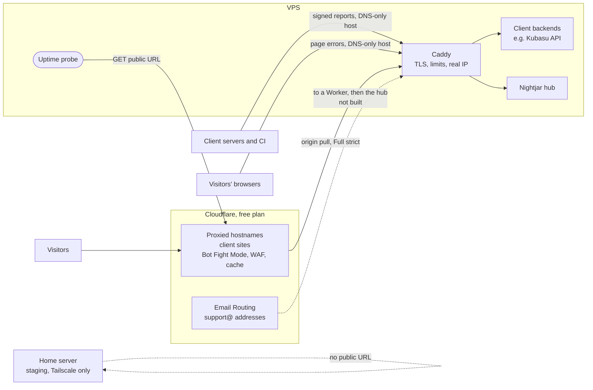

# Cloudflare checklist (free plan)

> **Status: planned, not applied.** No Cloudflare zone exists for these sites yet. This is the checklist to follow when
> the domains are pointed at Cloudflare, written for the **Free plan**, with **Caddy** staying as the web server in front
> of the hub (decision #53; nginx was considered and is not needed).

## How much to trust this page

Each claim is marked by where it came from, because several Cloudflare limits are easy to remember wrongly.

| Mark | Meaning |
|---|---|
| **Checked** | Read in Cloudflare's or Caddy's own documentation while writing this (October 2026) |
| **Tested** | Run here: Caddy 2 in Docker, in front of an echo server |
| **Unchecked** | From general knowledge, not confirmed. Verify before relying on it |

## A correction first

Earlier in this project I said a **WAF skip rule for the VPS's IP** would stop Cloudflare challenging the uptime probe.
**On the Free plan that is wrong for Bot Fight Mode.** Cloudflare's documentation says Bot Fight Mode "can't be skipped"
by WAF custom rules, Page Rules or Allow actions, because it runs in a separate pipeline. What does work is an **IP
Access Rule** that matches the request first, or keeping the hostname out of Cloudflare's proxy altogether. **Checked.**

## The short version

1. **The hub's own hostname is DNS-only** (grey cloud). Reports are small signed requests from servers and pages, and a
   challenge, a WAF block or a bot rule turns them into silence, because the reporters swallow failures by design.
2. **Client sites are proxied** (orange cloud), with SSL mode **Full (strict)**.
3. **Allow the VPS and the home IP** with IP Access Rules on every proxied zone, so Bot Fight Mode cannot challenge the
   uptime probe.
4. **Never cache `/api` or health routes.** Send `Cache-Control: no-store` from the app, and do not use "Cache Everything".
5. **Turn Always Online off**, or an outage can look like a working page.
6. **Harden the hub's Caddyfile** with the two small additions below, which are tested and applied.
7. **Prove it with a test report** that contains awkward text, through the real path, before trusting a site.

## What goes where



The probe goes **through** Cloudflare, so it measures what a visitor gets, including anything Cloudflare serves from
cache. Reports and the console go **straight** to Caddy on a hostname Cloudflare does not proxy.

### Decide each hostname

| Hostname | Proxied? | Why |
|---|---|---|
| `nightjar.<domain>` (the hub: ingest, console, API) | **No, DNS-only** | Nothing here benefits from Cloudflare, and a bot rule or managed rule can silently drop a report |
| A client's public site | Yes | Cache, TLS, DDoS protection, which is what the free plan is for |
| A client's API on the VPS | Yes, with care | See "The Kubasu path" below. It must not be cached |
| Staging on the home server | Not at all | Reached over Tailscale, never on the public internet |

Put the hub on a domain **you** own, not under a client's zone, so a client's Cloudflare settings can never affect it.

## Checklist

### 1. Account and zones

- [ ] One zone per domain, all on the Free plan. **Checked:** custom WAF rules are limited to **5 per zone** on Free.
- [ ] Two-factor authentication on the Cloudflare account. It holds the DNS for every client.
- [ ] Keep a note of which zone belongs to which client in the console's client list.

### 2. DNS

- [ ] The hub hostname: an `A` record with the cloud **grey** (DNS only).
- [ ] Client site records: orange (proxied) once the site is live and answering.
- [ ] No record for staging. It has no public address.
- [ ] Lower the TTL a day before any move, so a mistake is quick to undo.

### 3. SSL/TLS

- [ ] **Full (strict)** on every proxied zone. **Checked:** Cloudflare "strongly recommends" Full or Full (strict). Do not
      use Flexible: it sends traffic to the origin unencrypted, and **Unchecked:** it is commonly reported to cause
      redirect loops when the origin redirects HTTP to HTTPS, which Caddy does by default.
- [ ] **Certificates, per hostname:**
  - **The hub (DNS-only):** Caddy gets and renews a public certificate by itself, which is why Caddy was chosen
    (`FULL-DESIGN.md`). Nothing to do. A DNS-only hostname cannot use a Cloudflare Origin CA certificate anyway, because
    browsers do not trust it.
  - **A proxied client hostname:** **Unchecked:** Caddy's automatic certificate should also work behind the proxy, but
    confirm it on the first one. The fallback is a Cloudflare **Origin CA** certificate loaded with
    `tls /path/cert.pem /path/key.pem`. **Unchecked:** its validity period; look at the options when issuing one.
- [ ] Caddy redirects HTTP to HTTPS on its own, so the hub (which is not proxied) gets it with no Cloudflare setting.
- [ ] Still monitor certificate expiry (`INTEGRATE.md` asks for it). Automatic renewal is not a guarantee.

### 4. Bot Fight Mode, challenges and blocks

- [ ] **IP Access Rules (Allow)** for the VPS's address and your home address, on every proxied zone. This is the only
      way to keep Bot Fight Mode from challenging the uptime probe on the Free plan. **Checked.**
- [ ] Or turn Bot Fight Mode **off** on a zone whose site is only a brochure. It "may challenge API or mobile app
      traffic", and cannot be tuned on Free. **Checked.**
- [ ] Never enable **Under Attack** mode without remembering it will challenge the probe too.
- [ ] After setting a zone up, run the probe against it for a day and look for `HTTP 403` or `503` in the checks. A
      challenge page is a 403 or 503, which the console shows as an outage.

### 5. WAF custom rules (5 on Free)

- [ ] Do not spend rules on the hub: it is not proxied, so none apply to it.
- [ ] If a hub hostname ever has to be proxied: one rule with the **Skip** action for `starts_with(http.request.uri.path,
      "/ingest/")` that skips managed rules and rate limiting. **Checked:** Skip can skip managed rules and rate limiting
      rules, but not Bot Fight Mode.
- [ ] **Unchecked:** how the Free managed ruleset treats error text. Stack traces often contain SQL, file paths and
      `</script>`, which is exactly what attack rules look for. This is why the hub stays DNS-only, and why the test in
      step 12 uses awkward text.

### 6. Caching

- [ ] **Checked:** Cloudflare does not cache HTML or JSON by default, only by file extension (images, JS, CSS, fonts and
      so on). A `Cache-Control` of `private`, `no-store`, `no-cache` or `max-age=0`, a `Set-Cookie`, or any method other
      than `GET` also stops caching.
- [ ] Have the backend send `Cache-Control: no-store` on `/api/*` and on `/healthz`, so a rule added later cannot cache
      them by accident.
- [ ] **Do not use a "Cache Everything" rule on a zone that serves an API.** It overrides the default and can serve one
      visitor's response to another.
- [ ] **Checked:** **Always Online** exists on the Free plan and, when the origin is down, serves a stale copy or static
      parts from the Internet Archive, with a 30 day crawl interval on Free. That makes a dead origin return 200 and the
      probe say up. Leave it off. The page I read only describes turning it on, with a toggle in the domain's settings,
      so confirm the off switch there.

### 7. The real visitor address

- [ ] **Checked:** behind Cloudflare the socket address is Cloudflare's. The visitor is in `CF-Connecting-IP`, which
      Cloudflare recommends over `X-Forwarded-For` (that can hold a chain). `X-Forwarded-Proto` is set by Cloudflare to
      the protocol the visitor used, overwriting anything the visitor sent.
- [ ] **On the hub's DNS-only hostname, trust nothing.** **Tested:** Caddy already replaces a faked `X-Forwarded-For`
      with the socket address and sets `X-Forwarded-Proto` itself. It does **not** remove `CF-Connecting-IP` or
      `True-Client-IP`, and `hub/browser.py` reads `CF-Connecting-IP` first for its per-visitor limit, so a direct caller
      could fake it. The Caddyfile addition below strips both.
- [ ] **On a proxied hostname**, tell Caddy to trust only Cloudflare's published ranges. **Checked:** Caddy's
      `servers { trusted_proxies static <ranges> }` does this, nothing is trusted by default, and `client_ip_headers`
      defaults to `X-Forwarded-For` only, so add `CF-Connecting-IP`. Caddy's docs recommend `trusted_proxies_strict`
      for a proxy such as Cloudflare that adds addresses on the right of `X-Forwarded-For`. **Checked:** only the
      `static` source ships with Caddy; a list that updates itself needs a plugin.
- [ ] **Do not paste Cloudflare's ranges into the repository.** They change. Fetch `https://www.cloudflare.com/ips-v4` and
      `ips-v6` in a scheduled job, write them to a file, and `import` it. **Unchecked:** the exact headers the hub sees once
      this is on; verify with a test request.

### 8. Timeouts and sizes

- [ ] **Checked:** Cloudflare gives up on a slow origin after **125 seconds** (a 524) and limits URLs to 16 KB and
      headers to 128 KB. Nothing in Nightjar comes near them.
- [ ] **Unchecked:** the maximum upload size on Free. The documentation page I read did not state it. It only matters
      for a client app that takes large uploads.

### 9. Email (the planned `support@` intake)

- [ ] **Checked:** Email Routing is available on the Free plan and can send mail to a Worker as well as to an address.
- [ ] **Unchecked:** whether an Email Worker may call an outside URL. The page I read did not say. Workers can make
      requests in general, but test that the hub receives the mail before building the rest. Decision #7 depends on it.

### 10. The Kubasu path

Kubasu Motors is a React frontend on Cloudflare and a FastAPI backend on the VPS. Not started; these are the points to
settle first.

- [ ] Choose one origin or two: `kubasu.co.ke` for the frontend and `api.kubasu.co.ke` for the backend, or one hostname
      with `/api` routed to the VPS. Two is simpler and avoids a proxy rule.
- [ ] If two origins, the API must send CORS headers for the frontend's origin, and any cookie needs `SameSite` chosen on
      purpose.
- [ ] The API hostname is proxied only if the API sends `Cache-Control: no-store` (section 6).
- [ ] The API's own server errors go to the hub with a signed server reporter, and the frontend's errors with the
      browser reporter. Those talk to the hub's DNS-only hostname, not through the API.

### 11. Nightjar's own settings

- [ ] The probe URL for each client is a **`/healthz` path on the proxied hostname**, not the home page, so the check is
      cheap and never cached.
- [ ] Set `url` on the site only when the page is live (see the onboarding plan's "not launched" idea).
- [ ] `PROBE_INTERVAL_S` stays at 60. A shorter interval just trips more bot rules.

### 12. Prove it

Run these from the VPS, not from your laptop, so they see what the probe sees.

```bash
# 1. the probe's view: no challenge page, a real 200, and not served from cache
curl -sI -A "python-httpx/0.27" https://client.example.co.ke/healthz | grep -iE "^(HTTP|cf-cache-status|server)"
#    HTTP 200, cf-cache-status DYNAMIC or BYPASS. A 403 or 503 means a challenge: fix section 4.

# 2. the hub is reachable directly and Cloudflare is not in the path
curl -sI https://nightjar.example.co.ke/healthz | grep -iE "^(HTTP|server|cf-ray)"
#    HTTP 200, server Caddy, and NO cf-ray header.

# 3. a report with awkward text goes through. Use the onboarding screen's test event when it exists.
```

## Hardening the hub's Caddyfile

**Applied** to `deploy/Caddyfile` (the body limit and the two stripped headers; `caddy validate` passes on Caddy 2). **Tested:** `caddy validate` passes on Caddy 2, and in front of an echo server
this replaced a faked `X-Forwarded-For` with the real address, set `X-Forwarded-Proto` to the real scheme, removed a faked
`CF-Connecting-IP` and `True-Client-IP`, and answered a 100 KB body with 413. **Not tested:** certificate issue, and a real
Cloudflare in front.

```caddyfile
{$HUB_DOMAIN} {
	encode zstd gzip

	# Reports are small. The browser route refuses anything over 16 KB itself; this stops the body being read at all.
	request_body {
		max_size 64KB
	}

	handle /ingest/* {
		reverse_proxy hub:8000 {
			# The hub's hostname is DNS-only, so nobody in front of Caddy writes these: a caller did.
			header_up -CF-Connecting-IP
			header_up -True-Client-IP
		}
	}

	# ... the existing handle blocks for /healthz and the console stay as they are
}
```

**Caddy has no built-in rate limit. Tested:** 60 quick requests to the browser route all got 200. A third-party module
exists (**Unchecked**). For now the hub's own limits are the only brake: 120 reports a minute per key, 20 per visitor, and
10 new issues an hour per site (decision #50). That is enough for this scale, and it is the one thing nginx did better.

## Why Caddy stays, and nginx was not needed

nginx was considered because it is common and well documented, not because anything needed it. Weighing them for one hub on
one cheap VPS:

| | Caddy (kept) | nginx |
|---|---|---|
| Certificates | Automatic, including renewals | `certbot` plus a timer. A failed renewal is a silent outage in about 90 days |
| The hub on a DNS-only hostname | Works as it is | Needs a public certificate, so `certbot` |
| Rate limiting | None built in (**tested**) | `limit_req` built in. **Tested:** it answers 503 unless `limit_req_status 429` is set |
| Config | A few lines, and already written | More verbose |
| Risk of switching | None | The ingress is the one part every alert path crosses; a bad switch silences all of them |

**Revisit it if** client PHP or WordPress sites are to be hosted on this VPS directly, a client app needs an nginx-only
feature, or the lack of rate limiting in Caddy starts to matter. A tested nginx starting config for the hub is in this file's
history at commit `a19ea81`.

### Open question

**Should the console sit on the same hostname as ingest?** The Caddyfile above does, which exposes the console login to the
internet directly with no Cloudflare in front. A separate proxied hostname, ideally behind Cloudflare Access (**Unchecked:**
whether that is free for one user), would give the console a layer the ingest path deliberately does not have.

## Sources

Read while writing this, in October 2026:
[Bot Fight Mode](https://developers.cloudflare.com/bots/get-started/bot-fight-mode/),
[WAF custom rules](https://developers.cloudflare.com/waf/custom-rules/),
[the Skip action](https://developers.cloudflare.com/waf/custom-rules/skip/),
[SSL/TLS modes](https://developers.cloudflare.com/ssl/origin-configuration/ssl-modes/),
[default cache behaviour](https://developers.cloudflare.com/cache/concepts/default-cache-behavior/),
[Always Online](https://developers.cloudflare.com/cache/how-to/always-online/),
[HTTP headers](https://developers.cloudflare.com/fundamentals/reference/http-headers/),
[connection limits](https://developers.cloudflare.com/fundamentals/reference/connection-limits/),
[Email Routing](https://developers.cloudflare.com/email-routing/),
[Caddy global options](https://caddyserver.com/docs/caddyfile/options),
[Caddy reverse_proxy](https://caddyserver.com/docs/caddyfile/directives/reverse_proxy),
[Caddy request_body](https://caddyserver.com/docs/caddyfile/directives/request_body).
