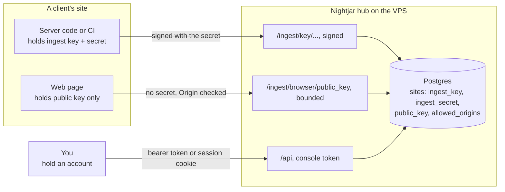
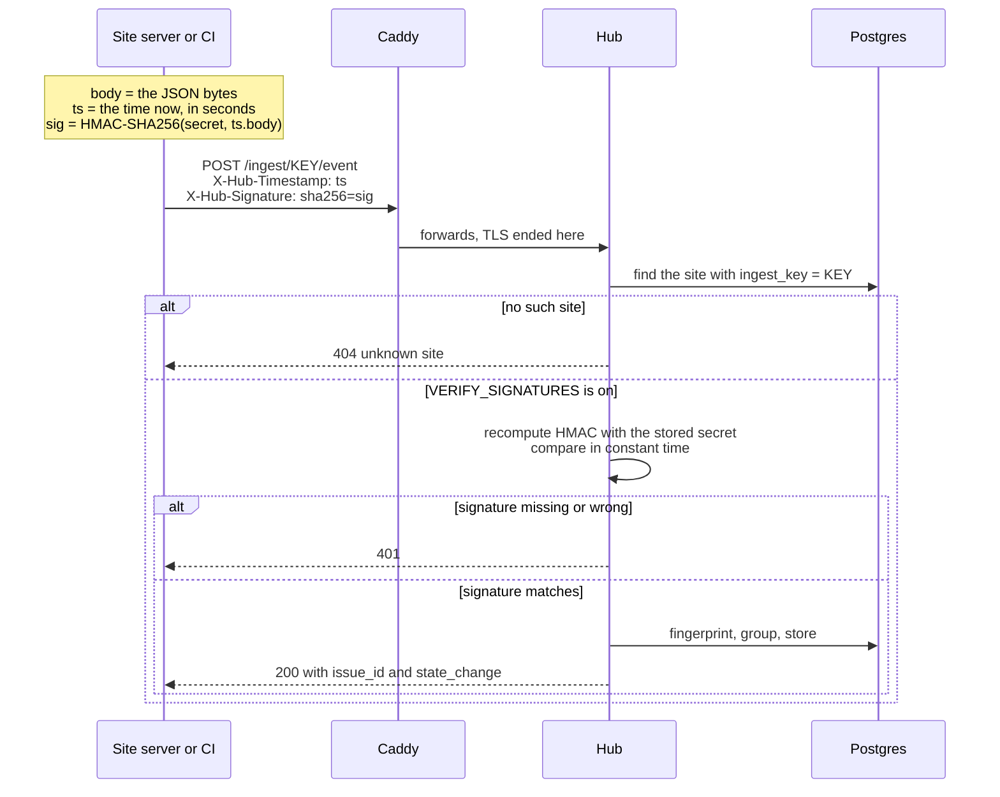
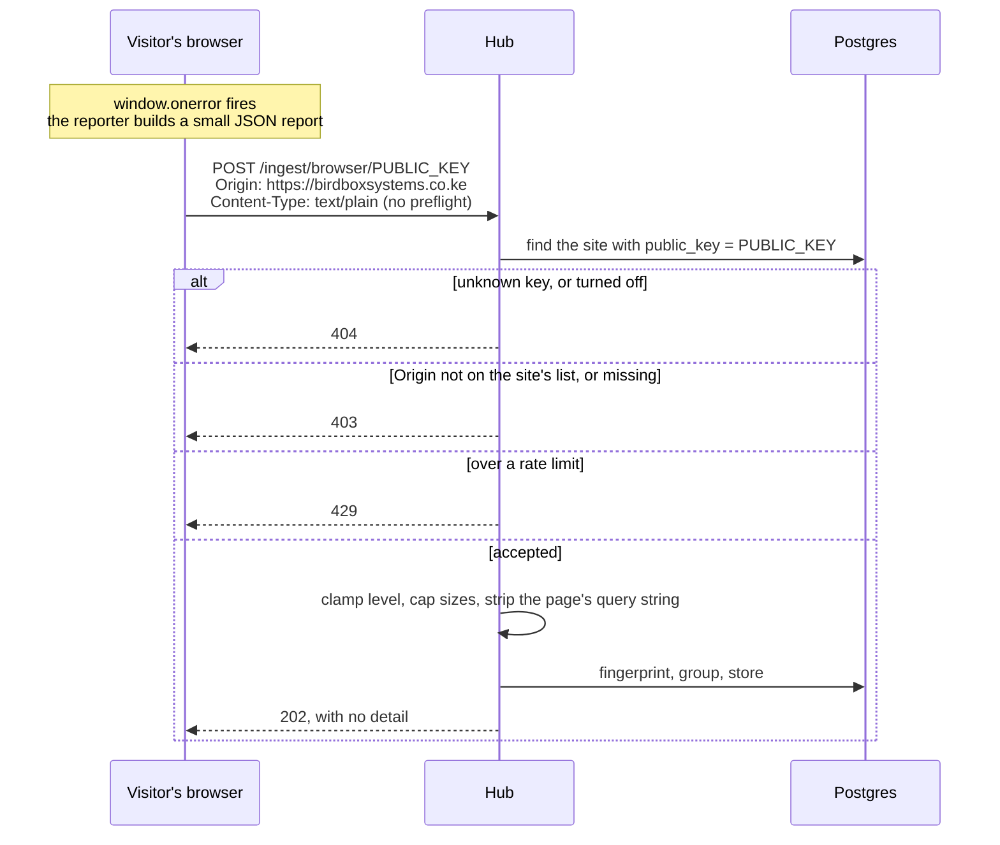
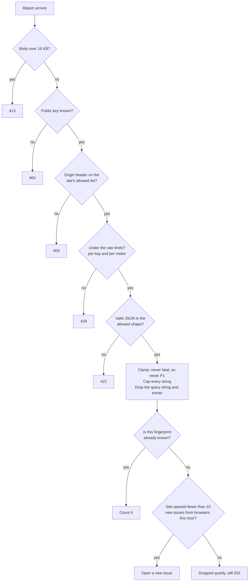
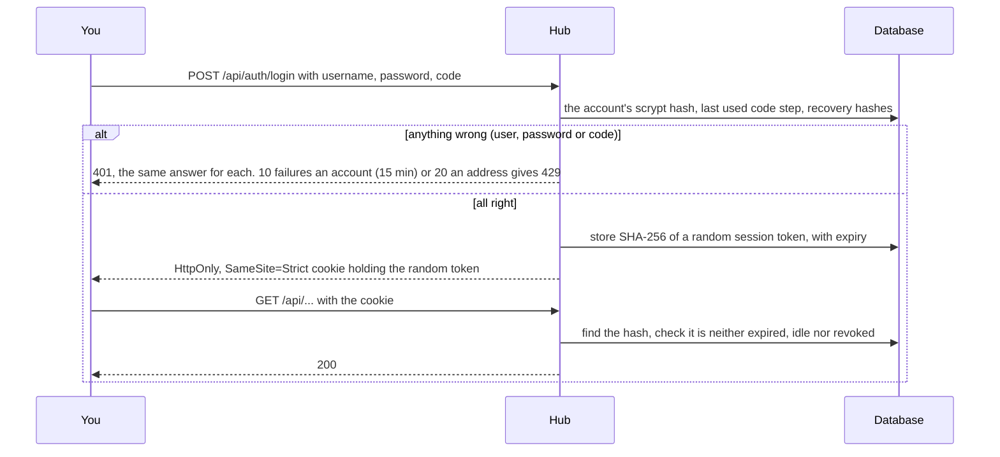
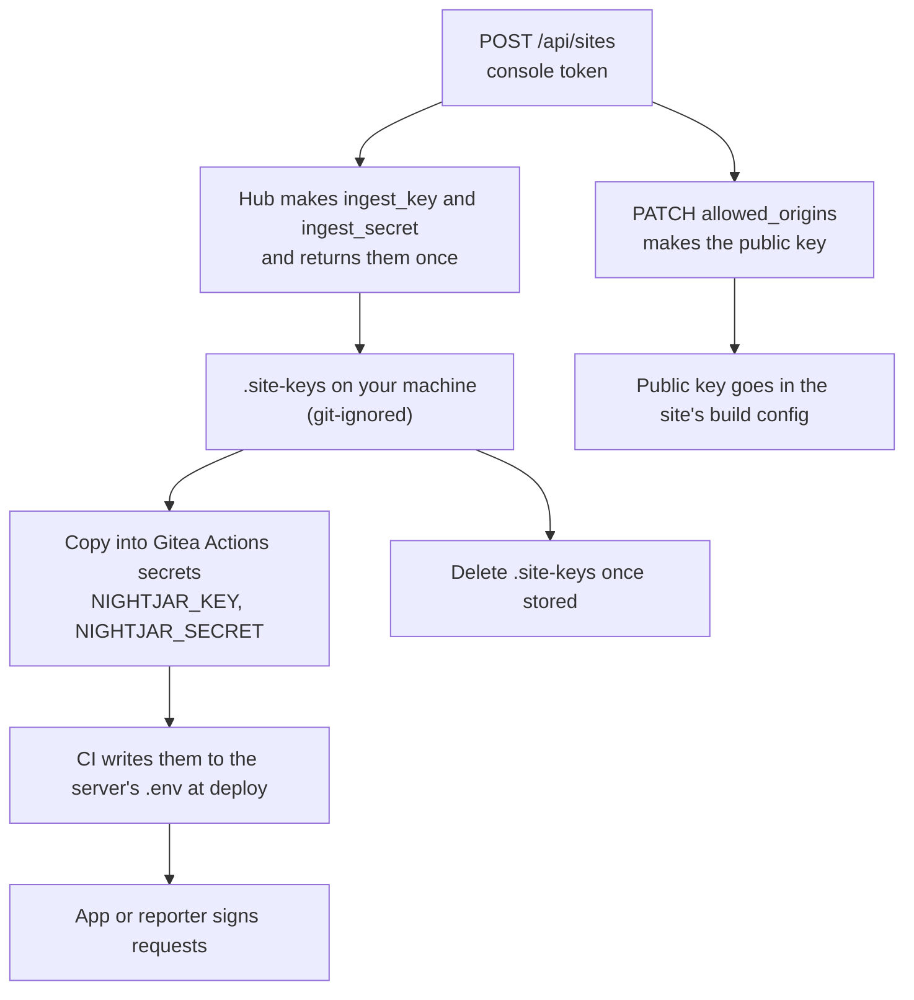

# Keys, secrets and tokens

Nightjar has five credentials. They look similar and do very different jobs, and mixing them up is the
easiest way to leak access. This page says what each one is, who holds it, what it can do, and what happens
when it leaks.

The diagrams are Mermaid. GitHub, Gitea and most Markdown viewers draw them.

## The short version

| Credential | What it is | Secret? | Held by | Can do | Where it lives |
|---|---|---|---|---|---|
| **Ingest key** | An address: which site is reporting. It is in the URL, `/ingest/<key>/event` | **No.** It also appears in access logs | The site's server, CI, reporters | Nothing on its own once signatures are on | Environment variable |
| **Ingest secret** (the private key) | Signs each request body with HMAC-SHA256. It is never sent | **Yes** | The site's server, CI, reporters | Report errors, deploys and stack state **as that one site** | Gitea Actions secret, then the server's `.env` |
| **Browser public key** | A separate address for web pages. It can only report errors, only from listed origins | **No, by design.** It is in the page source | A web page | Report errors for one site, within strict limits | The page's build config |
| **Master key** (`SECRET_MASTER_KEY`) | The one key every site's ingest secret is worked out from (below). Not in the database | **Yes, the most important one** | The hub only | Work out any site's ingest secret, so forge reports as every site | The VPS `secrets/secret_master_key` file, and a copy in your password manager |
| **Account** (password, authenticator, optional passkey) | Signs a person in to the console | **Yes** | That person | Their role: viewer reads, maintainer acts, owner also manages secrets, people and devices | Their password manager and phone |
| **Device token** (`njd_...`) | A machine's own access: the wall display, a script | **Yes** | That one machine | Read, or read and act. Never create a site, rotate a secret or issue access | The device's settings |
| **Console token** (`CONSOLE_TOKEN`) | Local development only. Retired once accounts are on | n/a | You | Everything, in local development | `.env` on your laptop |
| **Presence token** (`PRESENCE_TOKEN`) | Lets the NFC tap set home or away | **Yes** | Your iPhone Shortcut | Set presence, nothing else | The VPS `.env`, the Shortcut |

Two rules sit above the table:

1. **A console credential never goes in a client's CI, a client's server or a web page.** CI holds ingest
   credentials only (a device token is for your own scripts). A site's ingest credentials cannot read the console or mute an issue, because `/api`
   needs a signed-in session or a device token.
2. **The ingest secret never goes in a web page.** A page's source is public. That is why browsers get their own,
   weaker key.

## Who holds what



## Signed ingest: servers, CI and reporters

Everything that runs on a machine you or the client control uses the **ingest key** and the **ingest secret**.
That includes the server reporters in `client/` (Python, Node, PHP and Java), which read `NIGHTJAR_URL` (the hub),
`NIGHTJAR_KEY` and `NIGHTJAR_SECRET`. See [`REPORTERS.md`](REPORTERS.md).



How the signature is made. The HMAC is over the **timestamp, a dot and the raw request bytes**, so sign exactly what you
send. The timestamp is whole seconds since 1970, and it goes in the signature so a captured request expires:

```python
ts = str(int(time.time()))
sig = "sha256=" + hmac.new(secret.encode(), ts.encode() + b"." + body, hashlib.sha256).hexdigest()
# send them as the headers   X-Hub-Timestamp: <ts>   and   X-Hub-Signature: <sig>
```

The hub refuses a timestamp more than five minutes from its own clock (`SIGNATURE_MAX_AGE_S`), in either direction, so a
machine with a wrong clock is refused with `stale timestamp`: keep NTP on. A request with **no** timestamp is refused (`missing timestamp`),
because `REQUIRE_SIGNED_TIMESTAMP` is on by default. Set it `false` only for a copy of an old reporter that signs the body alone and cannot be updated yet.

```bash
# the same thing in a shell, which is what CI uses
TS="$(date +%s)"
SIG="sha256=$(printf '%s.%s' "$TS" "$BODY" | openssl dgst -sha256 -hmac "$NIGHTJAR_SECRET" -hex | sed 's/^.* //')"
curl -sS -X POST "$NIGHTJAR_URL/ingest/$NIGHTJAR_KEY/deploy" \
  -H "Content-Type: application/json" -H "X-Hub-Timestamp: $TS" -H "X-Hub-Signature: $SIG" -d "$BODY"
```

Why both a key and a secret? The key says **which site** and lets the hub find the right secret. The secret
proves the sender really is that site. Anyone can learn a key, since it sits in URLs and logs, and that is
fine, because a request with the right key and no valid signature is refused.

**`VERIFY_SIGNATURES=false` (local development) turns the check off.** Then the key alone is enough to post
anything. It must be `true` in production, and the hub refuses to start in that state without `SECRET_MASTER_KEY` (the authenticator codes are derived from it).

## Browser reporting: web pages

A page cannot keep a secret. So browsers use a different route with a different key, and the hub **bounds what
the key can do** instead of trusting who holds it.



What the hub checks, in order, and what each check is for:



| Check | Stops | Does **not** stop |
|---|---|---|
| Origin must be on the list | Another website using a key copied from your page | Someone with `curl`, who can send any `Origin` |
| Per-key and per-visitor rate limit | A script hammering the route | A patient attacker using many addresses |
| Level clamped to `warning` or `error` | A page asking for a P1 wake-up | Nothing; this one is absolute |
| Cap on **new** issues per site per hour | A flood of *different* junk errors, which fingerprinting cannot merge | Genuine bugs beyond the cap are dropped until the hour rolls over |
| Body and field size caps | Storage abuse | Nothing |

The Origin check is a filter, not authentication. The limits are what actually protect you.

### Turning it on for a site

```bash
# 1. list the pages allowed to report. This makes the public key. Setting origins is an owner action, so do it in the
#    console (Sites tab). A device token cannot: it is never an owner.
```

```ts
// 2. in the site's code, with the file client/browser/nightjar.ts copied in
import { init } from "./nightjar";
init({ hub: "https://nightjar.example", key: "<public_key>", release: "v1.4.2" });
```

Rules for origins: scheme and host only, such as `https://example.com` or `https://example.com:8443`. No path, no
wildcard, no `http://` except `localhost` for development. List `www` and the bare domain separately.

## Signing in: accounts, roles, passkeys and device tokens

In production you sign in with an account: a username, a password and an authenticator code, or a passkey in place of all three. There
is no shared console token any more (decision #59): machines each have a device token.



What each piece protects against:

- **The password** is stored only as a salted scrypt hash. A database copy does not give it away.
- **The authenticator secret is not in the database.** It is derived from `SECRET_MASTER_KEY` and the account's `totp_version`, the same
  way a site's ingest secret is, so a database copy alone cannot produce a code. Anyone holding the master key can: it is already the
  most dangerous secret here. Changing the master key breaks every authenticator, so run `reset-2fa` afterwards.
- **A code works once.** The last accepted 30-second step is stored, so a code seen over a shoulder or in a log cannot be replayed.
- **The session cookie is a random value; only its hash is stored.** A database copy cannot become a live session. Each session has an
  idle limit (7 days) and an absolute one (30), and ends on the server at logout, so a copied cookie dies with it.
- **Signed-in devices** (a link in the sidebar) lists sessions and ends one or all the others. Sign-ins, failures and revocations are in
  the audit trail without any secret in them.
- **Recovery codes** are eight single-use codes, stored as hashes, accepted in place of an authenticator code.

**Roles.** Viewer reads. Maintainer also acts on incidents and edits sites. Owner also creates sites, rotates secrets, sets browser keys and manages
people and devices. Enforced by the hub on every request. The last active owner cannot be demoted or disabled.

**Bringing someone in.** An owner adds them under *People and devices* and gets a one-time setup token (valid 48 hours, stored as a hash,
shown once). Hand it over yourself: nothing is emailed. They paste it on the sign-in page ("I have a setup token"), choose a password, add the
secret to an authenticator app, keep the recovery codes and enter a code. Until then the account cannot sign in. *Reset* gives a new token and
clears their password, authenticator and sessions. *Disable* ends their sessions at once.

**Passkeys.** *Passkeys* in the sidebar adds a phone, laptop or security key (asks for your password again). Sign-in then needs one touch
and no username, so it cannot be used to find out which usernames exist. Only the public key is stored. Your password and code keep
working, so a lost phone is not a lock-out. Set `HUB_PUBLIC_URL` (or `WEBAUTHN_RP_ID` and `WEBAUTHN_ORIGINS`): a passkey is bound to the
address it was made on, and changing the address later strands the passkeys already made.

**Device tokens.** One per machine, made under *People and devices*: `read` (a wall display) or `write` (a script), with an optional expiry.
Shown once, stored as a hash, revoked alone. A device is never an owner. A script sends `Authorization: Bearer njd_...`. A wall display
swaps its token once for a read-only session cookie at `POST /api/auth/device-login`; revoking the token ends that session on its next request.

In local development (`VERIFY_SIGNATURES` off) nothing changes: you type `CONSOLE_TOKEN`. Set `OPERATOR_LOGIN=true` to try accounts locally. With
accounts on, a `CONSOLE_TOKEN` left in the environment is ignored and the hub says so at start. The cookie is only marked `Secure` over
https, so use the console behind Caddy's TLS.

## Life of a site's credentials



`POST /api/sites` is the only time the secret is returned. The ingest key and the public key are shown again
whenever a site is edited, since neither is secret.

## Derived ingest secrets

The hub does not store a new site's ingest secret. It works it out: `HMAC-SHA256(master key, "nightjar-site-secret-v1|<site id>|<version>")`,
as 43 URL-safe characters. The app still holds an ordinary secret string and signs exactly as before, so no reporter changed. A copy of the
database alone now holds nothing that can forge a report.

- **Existing sites keep their stored secret** (`secret_version` 0) and keep verifying. The first **Rotate secret** moves a site to a derived
  one (version 1) and blanks the stored value; each rotation after that adds one to the version.
- **With no master key** (local development) new sites still get a stored secret. **Production refuses to start without one**, and a hub
  that has derived sites refuses to start if the key has gone missing.
- **The master key is now the thing to protect.** Leaked, it exposes every site at once; lost, every derived site needs a new secret
  (rotate each one with a new key set, and give each app its new value). It lives in `secrets/secret_master_key`, so keep a copy in your
  password manager apart from the database backups. A backup of the database plus the key is a full restore; either alone is not.
- It protects the database, not the machine: anyone who can read the hub's secrets directory has the key.

## If one leaks

| Leaked | What an attacker can do | What to do |
|---|---|---|
| **Ingest key only** | Nothing useful once signatures are on. It is an address | Nothing |
| **Master key** | Forge reports as **every** derived site | Set a new `SECRET_MASTER_KEY`, restart, then rotate every site and give each app its new secret. Until a site is rotated its reports are refused |
| **Ingest secret** | Post fake errors, fake deploys and fake stack reports **as that one site**. They cannot read anything, mute anything or touch another site | Rotate it (below), update the app's environment, redeploy |
| **Browser public key** | Post error reports from `curl`, within the rate limits and new-issue cap. Cannot read, cannot reach another route, cannot be P1 | Empty `allowed_origins` to revoke it, then set them again for a new key |
| **Device token** | What its scope allows: read, or read and act (never owner) | *People and devices*, **Revoke** that one. Nothing else is affected |
| **Account (password and code)** | Their role, as that person | Owner: *Disable*, then *Reset*. Or `operator_cli sign-out-everywhere` and `reset-2fa`. Remove their passkeys by disabling the account |
| **Console token** | Local development only | Change `CONSOLE_TOKEN` in your `.env` |
| **Presence token** | Set home or away. This can only change which channels fire, never whether something alerts | Change `PRESENCE_TOKEN` and update the Shortcut |

**Rotating an ingest secret.** Use **Rotate secret** on the site's row in the console's Sites tab (or
`POST /api/sites/{id}/rotate-secret`). The new secret is shown once, and the old signatures stop working immediately, so have
the app's settings open before you press it. If the console is not available, **and the site still has a stored secret** (its
`secret_version` is 0), it is one SQL statement. A derived site cannot be rotated this way, because its secret is not
in the database; use the console or the API:

```bash
NEW=$(python -c "import secrets; print(secrets.token_urlsafe(24))")
docker compose exec db psql -U nightjar -d nightjar \
  -c "UPDATE sites SET ingest_secret = '$NEW' WHERE name = 'bird-box-systems';"
echo "$NEW"   # put this in the Gitea secret, then redeploy
```

Rotating the ingest **key** is the same statement on `ingest_key`, and also changes the URL the app posts to.

## Noticing a leak

A valid signature proves that someone holds the secret, not who. The hub therefore cannot tell a report forged with a leaked secret from a
real one, and it does not pretend to. It keeps two pieces of evidence (`hub/sources.py`) and shows them; it never decides.

| Evidence | Recorded when | Shown as |
|---|---|---|
| **Refused requests** | a signed request for a known site gets a 401: missing or wrong signature, missing, malformed or stale timestamp | **refused N in 24 h** on the site's row in the Sites tab, and a *Request refused* line in its History (at most five an hour, so a flood cannot bury the trail; the count keeps going) |
| **New source address** | a report is accepted from an address that site has never reported from. The first address a site is ever seen from is its baseline and says nothing | **new address, 3 h ago** on the row for a week, and a *Report from a new address* line in History |

What each means:

- **Refused requests** mean either someone has the ingest key (it is in every URL and every access log) and is guessing at the secret, or an
  app is still holding a secret you just rotated. After a rotation, a few are expected from the app you have not updated yet; the reporters now
  say so in that app's own log. A steady stream from an address you do not recognise is the thing to act on.
- **A new address** is the closest thing the hub has to seeing a leaked secret used. It is also what a site that moved host looks like, and a
  Cloudflare or Caddy change that alters which address the hub sees. Check it against what you did that day before rotating.
- **Neither sends a notification.** Waking the phone on a guess would break the rule that a notification that did not need to be sent is a bug,
  and either signal can be innocent. They are for the morning pass. (A decoy credential that no legitimate caller has would be different; it is not built.)

How it works and where it stops:

- The address comes from `CF-Connecting-IP`, then `X-Forwarded-For`, then the socket. Behind Caddy that is the real caller. If the hub were
  reachable directly, a caller could write anything there, so the address is evidence and not proof. A forger who copies a site's usual address
  is not seen at all.
- Unknown ingest keys are not recorded: that is internet noise, and storing it would let anyone fill the table.
- Sources are written at most once a minute per address, so a crash storm is not a write storm. Refused-request counts are per address,
  reason and hour and are kept for 30 days. Neither stores a request body, a signature or a secret (`tests/test_sources.py` checks).
- The addresses are those of servers, not visitors. The browser route is separate and records none of this.
- Recording can never break ingest: if the database write fails, the report is still accepted and the failure is logged.

## Leak runbook

Read this before you need it. When something leaks you will be tired and in a hurry, and the order matters more than the speed.

**The order, for every credential: revoke, rotate, delete, record.**

1. **Revoke.** Make the exposed value stop working. Do this first, before you work out how it got out. Assume it was read.
2. **Rotate.** Make a new one and put it where the app expects it, so the app is not left broken.
3. **Delete.** Remove the old value from wherever it was exposed (a commit, a log, a chat, a screenshot, a ticket). This is tidying, not
   protection: a value that was public for a minute is compromised for good, which is why revoking comes first. Rewriting git history does
   not un-leak anything that was already pushed or cloned.
4. **Record.** Write down what leaked, when, how you found out, what it could do, and what you did. For a site's secret the hub already
   records the rotation (the site's **History** button); the rest is yours to write, in whatever notes you keep, within the day.

Rotating **needs the console** and an owner sign-in. If a device token or an account leaked, deal with that one first.

### Ingest secret (one site)

Reach: forge errors, deploys and stack state as that one site. Nothing else.

1. **Revoke and rotate in one step:** Sites tab, that site, **Rotate secret**. The old secret stops working at once. (API:
   `POST /api/sites/{id}/rotate-secret` with an owner session; a device token cannot.) The new secret is shown once, so have the next step open before you press it.
2. Put the new value in the Gitea Actions secret `NIGHTJAR_SECRET`, then redeploy the app (or edit its `.env` and restart it). Until you do,
   that site's reports are refused with 401, which is the intended failure: it is loud on the hub's side, not silent.
3. **Check:** send a test event from the Sites tab (**Test**), and send one signed with the *old* secret and confirm it gets `401`.
   `./test_ingest.sh <ingest_key>` with `NIGHTJAR_SECRET` set to each value does both.
4. **Delete** the old value from CI, shell history, `.site-keys` and wherever it was seen.
5. **Record.** The History button shows `secret_rotated, derived, version N`.

If you cannot reach the console, a site that still has a stored secret (`secret_version` 0) can be rotated with the SQL above. A derived
site cannot, because its secret is not in the database.

### Browser public key (one site)

Reach: post error reports from `curl` within the rate limits and new-issue cap. It cannot be P1 and cannot read anything.

1. **Revoke:** Sites tab, **Edit**, empty the allowed pages, **Save**. The key stops working immediately.
2. **Rotate:** add the pages back and **Save**. This makes a new key. Put it in the site's build config and redeploy.
3. **Check:** a report to the old key returns 404.
4. **Delete / record:** nothing secret was exposed, so there is little to delete. The History button shows `browser_key_revoked` and `browser_key_issued`.

### Console token

Reach: everything, including creating sites, rotating secrets and muting issues. This is the worst one short of the master key.

1. **Revoke and rotate:** on the VPS write a new value into `secrets/console_token` (`openssl rand -base64 32 | tr -d '\n' > secrets/console_token`),
   then `docker compose restart hub`. This ends the bearer token only. **Signed-in browsers are not affected**, because their sessions
   are separate: if the exposure might include a session, also run `docker compose exec hub python -m hub.operator_cli sign-out-everywhere --username you`
   (in token mode, local development, the restart does end every session).
2. Sign in with the new token and put it in your password manager.
3. **Check:** the old token returns 401 (`curl -H "Authorization: Bearer <old>" https://<hub>/api/sites`).
4. **Assume the attacker used it.** Open each site's **History** and look for changes you did not make (a new URL, new browser pages, a rotation).
   If any site's secret was displayed or rotated while the token was exposed, rotate that site again.
5. **Delete / record** as above. There is no audit line for a token change; write it down.

### Presence token

Reach: set home or away. That changes which channels fire, never whether something alerts.

1. **Revoke and rotate:** write a new value into `secrets/presence_token`, `docker compose restart hub`.
2. Update the iOS Shortcut that taps the NFC tag, and tap once.
3. **Check:** the old value returns 401 from `POST /presence`, the new one 200. Confirm a push still arrives with presence away: it must.
4. **Delete / record** as above.

### Master key (`SECRET_MASTER_KEY`)

Reach: work out the secret of every derived site, so forge reports as all of them. Rare, and the most work.

1. **Revoke:** put a new key in `secrets/secret_master_key` (`openssl rand -base64 32 | tr -d '\n'`) and `docker compose restart hub`. Every derived
   site's reports are now refused with 401, because their secrets came from the old key. That is the revoke.
2. **Rotate every site:** Rotate secret on each one in the Sites tab, update each app, redeploy. A site stays refused until you do.
   A site you have not got to yet is down in the sense of *not reporting*; the Sites tab shows it as never or long since reported.
3. **Check:** one site at a time, as for an ingest secret.
4. Put the new key in your password manager and **delete** the old one. **Record** the date, because every backup of the database
   restores with the key that was current when you restore it, so keep the old key alongside any backup older than this.

### Not covered here

The Pushover keys, the Postgres password and the `age` backup key are not in this runbook yet. The backup key's loss is in `DEPLOY.md`.

### The drill

A runbook nobody has tried is a hypothesis. The steps for an ingest secret are exercised by the tests (`tests/test_derived_secrets.py`: rotating
refuses the old secret and accepts the new one), but that is not you doing it under stress with a real app.

**Status: rehearsed, not drilled.** The real drill needs a deployed hub and a real app, and neither exists yet. Reading the runbook through did find one fault,
now fixed: the two `tr -d '\n'` commands (console token and master key) had lost their backslash, so the command was split over two
lines and, copied from the rendered page, would have left a newline at the end of the secret file.

**Rehearsal, 3 November 2026.** Run by Claude on a development machine, against a throwaway hub and database (signatures and the
console token on, a master key set), not a deployment and not a person under stress. It proves the commands and the failure modes, not the
timing. Everything below behaved as this page says:

| Step | Result |
|---|---|
| Signed event with the current secret | accepted |
| Rotate secret (`POST /api/sites/{id}/rotate-secret`) | 0.3 s; the new secret differs from the old |
| Sites tab **Test** (`test-event`) | 200 |
| Event signed with the new secret | accepted |
| Event signed with the **old** secret | `401`, `{"detail":"bad signature"}` |
| An app still holding the old secret | its reporter logged `the hub answered 401 to a report ... Check the site's key and secret.`; with the new secret it logged nothing |
| History | `secret_rotated, derived, version 2` |
| Console token changed, hub restarted (4 s) | old bearer token `401`, new `200`, and a session cookie made with the old token `401` |
| Presence token changed, hub restarted | old `401`, new `200` |
| A rotated secret across that restart | still accepted (derived from the master key, not lost) |

Two things it showed: `./test_ingest.sh` prints `bad signature` for a refused secret but not the status, and its hint ("re-run with
`NIGHTJAR_SECRET` set") is wrong when you are deliberately using the old secret, so read that line as the refusal you wanted. And it was
not run for the master key, the Pushover keys, the Postgres password or the backup key.

**When the hub is deployed**, do this once, with a stopwatch, on one real site that is not a client's production site, and fill in the
table. Anything in the "unclear" column is a fix to this page, so change the page in the same sitting.

| Step | Command or place | Seconds | Unclear or wrong? |
|---|---|---|---|
| 1. Have the app's settings open | Gitea `NIGHTJAR_SECRET`, or the app's `.env` | | |
| 2. Rotate | Sites tab, that site, **Rotate secret** | | |
| 3. Put the new value in and redeploy | Gitea secret, then the app's deploy | | |
| 4. Test event with the new secret | Sites tab, **Test**, expect it accepted | | |
| 5. Send with the old secret | `NIGHTJAR_SECRET=<old> ./test_ingest.sh <ingest_key>`, expect `bad signature` (a 401) | | |
| 6. The app's own reporter says so | While the app still has the old secret, its log should show `the hub answered 401 to a report ... Check the site's key and secret.` | | |
| 7. Read the History button | expect `secret_rotated, derived, version N` | | |

Then repeat steps 1 to 3 of the **console token** and **presence token** runbooks the same way (rotate, restart, old value returns 401),
and write the total time at the bottom. Skip the master key unless you are prepared to rotate every site.

Step 6 is new: since the reporters now say so in the app's log when the hub refuses a report, a rotation that was not carried through
to the app is visible there instead of looking like an app with no errors.

## Where each one is kept

| Place | Holds | Rules |
|---|---|---|
| `.site-keys` (repo root) | Every site's key and secret, written when sites were created | Git-ignored. Move the values into Gitea secrets, then delete the file |
| **Gitea Actions secrets** | Each site's `NIGHTJAR_KEY` and `NIGHTJAR_SECRET` | The preferred home: rotation is one edit, not a hunt across servers |
| The server's `.env` (`chmod 600`) | The same, written by CI at deploy | Never committed |
| The VPS `secrets/` directory | `secret_master_key`, `console_token` and the rest | Never committed. Copy `secret_master_key` to your password manager |
| The VPS `.env` | `CONSOLE_TOKEN`, `PRESENCE_TOKEN`, `POSTGRES_PASSWORD` | Never committed. `CONSOLE_TOKEN` needs 16 characters or more |
| A page's build config | The browser public key | Safe to commit. It is public by design |
| Your password manager | The console token | The only copy outside the VPS |

## Limits worth knowing

- **A captured request can still be replayed for five minutes.** Reporters sign a timestamp and the hub refuses one older
  than `SIGNATURE_MAX_AGE_S` (300), so a capture expires, and a fresh timestamp cannot be attached to an old capture. Inside
  the window a replay is accepted and recorded again; the damage is a duplicate row, not access. The one case that matters: a replayed
  **heartbeat** can keep a job looking alive for up to five minutes after it has really stopped. A heartbeat interval shorter than
  that cannot be hidden this way for long, and the silence is still found at the next missed interval. There is no nonce on purpose:
  remembering every signature seen would be state that must survive restarts, for a window this short. A request sent with **no**
  timestamp is refused unless you turn `REQUIRE_SIGNED_TIMESTAMP` off, which would make an old capture of one replayable for ever.
- **Keys appear in Caddy's access log**, because they are in the URL. That is acceptable for an identifier that is
  not secret, which is why signatures matter. Never put a secret in a URL. The one exception is Pushover's acknowledgement callback
  (`/pushover/ack/<token>`), which cannot sign anything: its path is redacted in Caddy's log and in uvicorn's access log
  (`hub/logfilter.py`), and forging an acknowledgement also needs a receipt only Pushover and the hub know.
- **The browser limits are in memory.** A hub restart resets them. They are a brake, not an accounting system.
- **The hub reads the caller's address from a header** (`CF-Connecting-IP`, then `X-Forwarded-For`). The hub's hostname is
  DNS-only, so Caddy removes `CF-Connecting-IP` and `True-Client-IP` on every route and writes `X-Forwarded-For` itself; a caller
  cannot choose their address. If the hub is ever put behind Cloudflare, or reachable without Caddy, that stops being true and
  the per-address sign-in limits can be dodged: see `docs/CLOUDFLARE.md` before doing either.
- **The uptime probe stays on public addresses** (`hub/netguard.py`). It refuses private, loopback and metadata targets, including
  through redirects, unless you list a network in `PROBE_ALLOWED_NETWORKS`. A name that changes its answer between the hub's check and
  its request (DNS rebinding) could still get through; nothing the probe fetches is shown back to anyone.
- **A Cloudflare Worker is the upgrade path** if browser abuse ever becomes real: the Worker holds a secret,
  signs on the page's behalf and adds its own checks, so the page never talks to the hub directly. It is not
  built because the bounds above are enough for now and a Worker is another thing to maintain.
