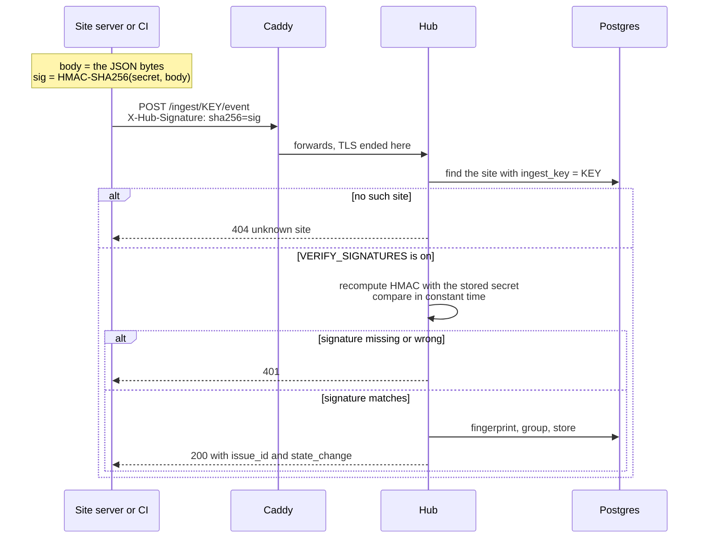
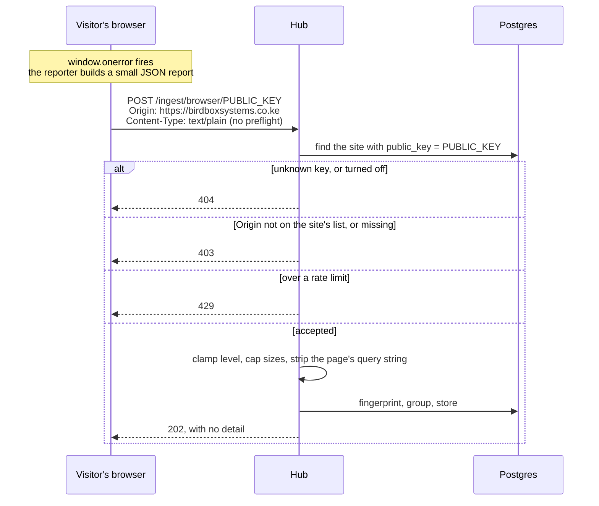
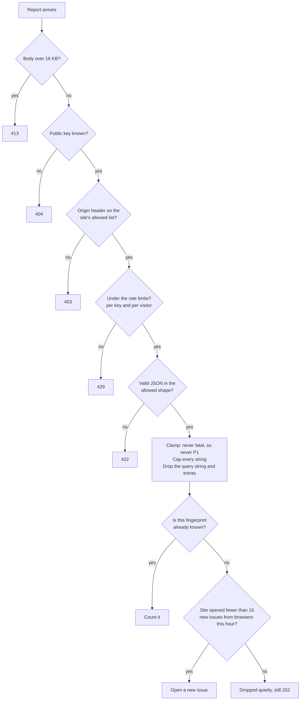
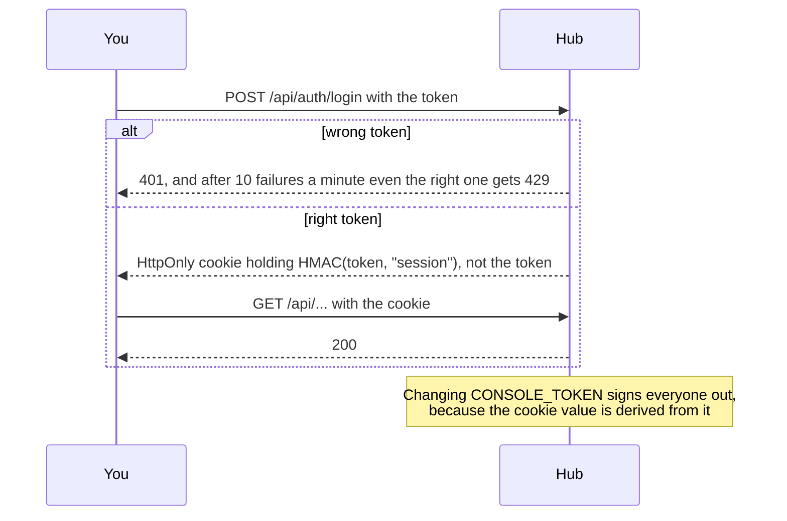
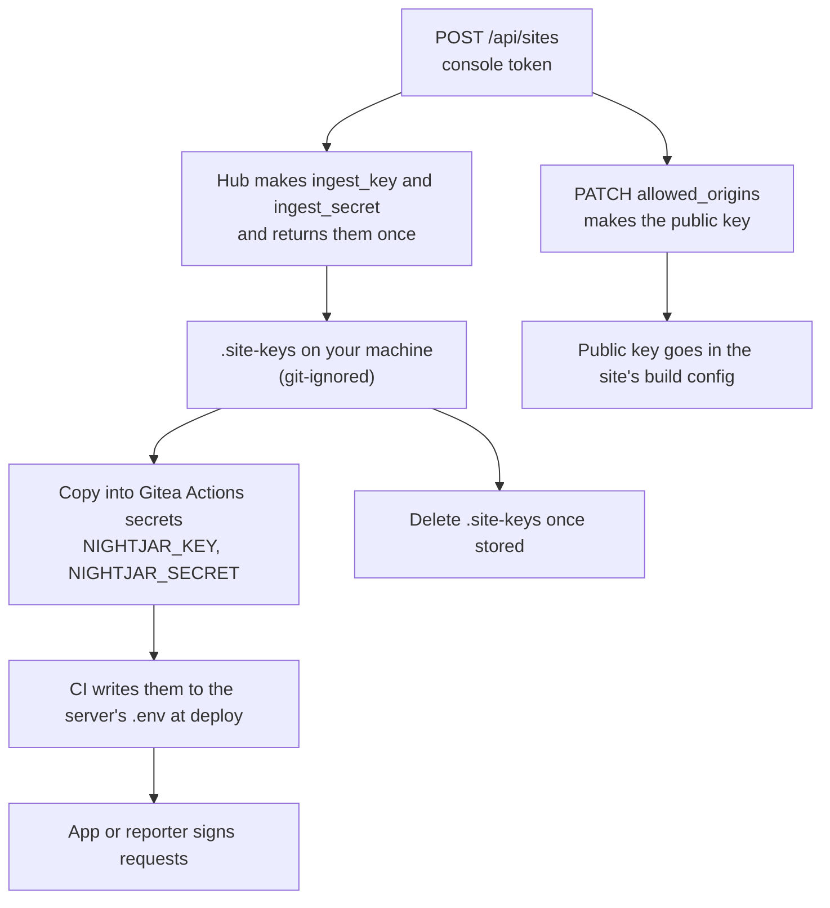

# Keys, secrets and tokens

Nightjar has five credentials. They look similar and do very different jobs, and mixing them up is the
easiest way to leak access. This page says what each one is, who holds it, what it can do, and what happens
when it leaks.

The diagrams are Mermaid. GitHub, Gitea and most Markdown viewers draw them.

## The short version

| Credential | What it is | Secret? | Held by | Can do | Where it lives |
|---|---|---|---|---|---|
| **Ingest key** | An address: which site is reporting. It is in the URL, `/ingest/<key>/event` | **No.** It also appears in access logs | The site's server, CI, reporters | Nothing on its own once signatures are on | Environment variable |
| **Ingest secret** (the private key) | Signs each request body with HMAC-SHA256. It is never sent | **Yes** | The site's server, CI, reporters | Report errors, deploys and stack state **as that one site** | Gitea Actions secret, then the server's `.env` |
| **Browser public key** | A separate address for web pages. It can only report errors, only from listed origins | **No, by design.** It is in the page source | A web page | Report errors for one site, within strict limits | The page's build config |
| **Console token** (`CONSOLE_TOKEN`) | Signs you in to the console and `/api` | **Yes** | You only | Everything: read, resolve, mute, create sites | The VPS `.env`, your password manager |
| **Presence token** (`PRESENCE_TOKEN`) | Lets the NFC tap set home or away | **Yes** | Your iPhone Shortcut | Set presence, nothing else | The VPS `.env`, the Shortcut |

Two rules sit above the table:

1. **The console token never goes in a client's CI, a client's server or a web page.** CI holds ingest
   credentials only. A site's ingest credentials cannot read the console or mute an issue, because `/api`
   needs the console token.
2. **The ingest secret never goes in a web page.** A page's source is public. That is why browsers get their own,
   weaker key.

## Who holds what


## Signed ingest: servers, CI and reporters

Everything that runs on a machine you or the client control uses the **ingest key** and the **ingest secret**.
That includes the server reporters in `client/` (Python, Node, PHP and Java), which read `NIGHTJAR_URL` (the hub),
`NIGHTJAR_KEY` and `NIGHTJAR_SECRET`. See [`REPORTERS.md`](REPORTERS.md).



How the signature is made. The HMAC is over the **raw request bytes**, so sign exactly what you send:

```python
sig = "sha256=" + hmac.new(secret.encode(), body, hashlib.sha256).hexdigest()
# send it as the header   X-Hub-Signature: <sig>
```

```bash
# the same thing in a shell, which is what CI uses
SIG="sha256=$(printf '%s' "$BODY" | openssl dgst -sha256 -hmac "$NIGHTJAR_SECRET" -hex | sed 's/^.* //')"
curl -sS -X POST "$NIGHTJAR_URL/ingest/$NIGHTJAR_KEY/deploy" \
  -H "Content-Type: application/json" -H "X-Hub-Signature: $SIG" -d "$BODY"
```

Why both a key and a secret? The key says **which site** and lets the hub find the right secret. The secret
proves the sender really is that site. Anyone can learn a key, since it sits in URLs and logs, and that is
fine, because a request with the right key and no valid signature is refused.

**`VERIFY_SIGNATURES=false` (local development) turns the check off.** Then the key alone is enough to post
anything. It must be `true` in production, and the hub refuses to start in that state without a console token.

## Browser reporting: web pages

A page cannot keep a secret. So browsers use a different route with a different key, and the hub **bounds what
the key can do** instead of trusting who holds it.



What the hub checks, in order, and what each check is for:



| Check | Stops | Does **not** stop |
|---|---|---|
| Origin must be on the list | Another website using a key copied from your page | Someone with `curl`, who can send any `Origin` |
| Per-key and per-visitor rate limit | A script hammering the route | A patient attacker using many addresses |
| Level clamped to `warning` or `error` | A page asking for a P1 wake-up | Nothing; this one is absolute |
| Cap on **new** issues per site per hour | A flood of *different* junk errors, which fingerprinting cannot merge | Genuine bugs beyond the cap are dropped until the hour rolls over |
| Body and field size caps | Storage abuse | Nothing |

The Origin check is a filter, not authentication. The limits are what actually protect you.

### Turning it on for a site

```bash
# 1. list the pages allowed to report. This makes the public key. Use your console token.
curl -X PATCH https://nightjar.example/api/sites/9 \
  -H "Authorization: Bearer $CONSOLE_TOKEN" -H "Content-Type: application/json" \
  -d '{"allowed_origins": ["https://birdboxsystems.co.ke", "https://www.birdboxsystems.co.ke"]}'
# the reply includes "public_key": "..."
```

```ts
// 2. in the site's code, with the file client/browser/nightjar.ts copied in
import { init } from "./nightjar";
init({ hub: "https://nightjar.example", key: "<public_key>", release: "v1.4.2" });
```

Rules for origins: scheme and host only, such as `https://example.com` or `https://example.com:8443`. No path, no
wildcard, no `http://` except `localhost` for development. List `www` and the bare domain separately.

## Console token and sessions



Scripts can skip the cookie and send `Authorization: Bearer <token>`. The cookie is only marked `Secure` over
https, so use the console behind Caddy's TLS.

## Life of a site's credentials



`POST /api/sites` is the only time the secret is returned. The ingest key and the public key are shown again
whenever a site is edited, since neither is secret.

## If one leaks

| Leaked | What an attacker can do | What to do |
|---|---|---|
| **Ingest key only** | Nothing useful once signatures are on. It is an address | Nothing |
| **Ingest secret** | Post fake errors, fake deploys and fake stack reports **as that one site**. They cannot read anything, mute anything or touch another site | Rotate it (below), update the app's environment, redeploy |
| **Browser public key** | Post error reports from `curl`, within the rate limits and new-issue cap. Cannot read, cannot reach another route, cannot be P1 | Empty `allowed_origins` to revoke it, then set them again for a new key |
| **Console token** | Everything, including creating sites and muting issues | Change `CONSOLE_TOKEN` in the VPS `.env` and restart. Every session ends at once |
| **Presence token** | Set home or away. This can only change which channels fire, never whether something alerts | Change `PRESENCE_TOKEN` and update the Shortcut |

**Rotating an ingest secret.** There is no rotate endpoint yet, so it is one SQL statement. The old signatures
stop working immediately, so have the new secret ready for the app before you run it:

```bash
NEW=$(python -c "import secrets; print(secrets.token_urlsafe(24))")
docker compose exec db psql -U nightjar -d nightjar \
  -c "UPDATE sites SET ingest_secret = '$NEW' WHERE name = 'bird-box-systems';"
echo "$NEW"   # put this in the Gitea secret, then redeploy
```

Rotating the ingest **key** is the same statement on `ingest_key`, and also changes the URL the app posts to.

## Where each one is kept

| Place | Holds | Rules |
|---|---|---|
| `.site-keys` (repo root) | Every site's key and secret, written when sites were created | Git-ignored. Move the values into Gitea secrets, then delete the file |
| **Gitea Actions secrets** | Each site's `NIGHTJAR_KEY` and `NIGHTJAR_SECRET` | The preferred home: rotation is one edit, not a hunt across servers |
| The server's `.env` (`chmod 600`) | The same, written by CI at deploy | Never committed |
| The VPS `.env` | `CONSOLE_TOKEN`, `PRESENCE_TOKEN`, `POSTGRES_PASSWORD` | Never committed. `CONSOLE_TOKEN` needs 16 characters or more |
| A page's build config | The browser public key | Safe to commit. It is public by design |
| Your password manager | The console token | The only copy outside the VPS |

## Limits worth knowing

- **Signatures have no timestamp.** A captured signed request can be replayed and would be recorded again. The
  damage is a duplicate event or deploy row, not access. Fixing it means adding a timestamp to the signed body,
  which is a change to every reporter.
- **Keys appear in Caddy's access log**, because they are in the URL. That is acceptable for an identifier that is
  not secret, which is why signatures matter. Never put a secret in a URL.
- **The browser limits are in memory.** A hub restart resets them. They are a brake, not an accounting system.
- **Behind Cloudflare or Caddy the hub reads the visitor's address from a header** (`CF-Connecting-IP`, then
  `X-Forwarded-For`). A caller can fake it to dodge the per-visitor limit, but the per-key limit and the new-issue
  cap still hold.
- **A Cloudflare Worker is the upgrade path** if browser abuse ever becomes real: the Worker holds a secret,
  signs on the page's behalf and adds its own checks, so the page never talks to the hub directly. It is not
  built because the bounds above are enough for now and a Worker is another thing to maintain.
