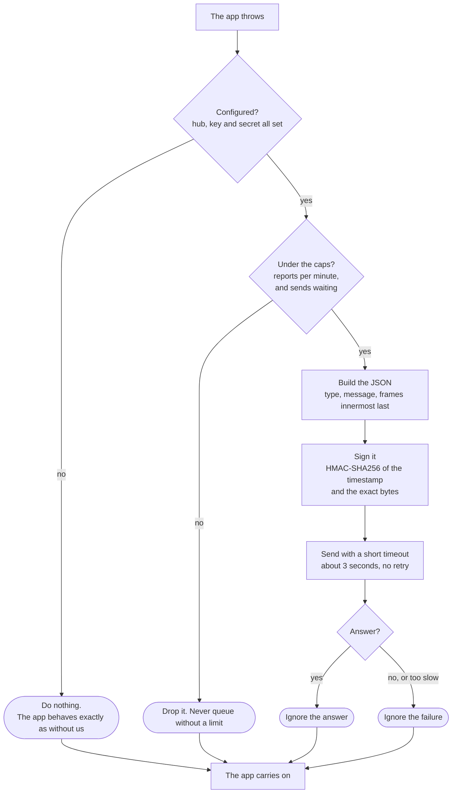

# Reporters: sending errors to the hub from any stack

A **reporter** is the small piece of code inside a client's app that sends its errors to Nightjar. There is one for
each stack in use. They all do the same job, in the same way, so this page describes the shared contract once and
then each language.

| Stack | File | Needs | Credential | Tested on |
|---|---|---|---|---|
| Python (FastAPI) | [`client/reporter.py`](../client/reporter.py) | `httpx`, `fastapi` | ingest secret | the original reporter |
| Node, Express | [`client/node/nightjar.ts`](../client/node/nightjar.ts) | Node 18 or newer | ingest secret | Node 24 |
| PHP, Laravel, WordPress | [`client/php/Nightjar.php`](../client/php/Nightjar.php) | PHP 7.4 or newer | ingest secret | PHP 7.4, 8.3 |
| Java, Spring | [`client/java/Nightjar.java`](../client/java/Nightjar.java) | Java 11 or newer | ingest secret | JDK 24, compiled for 11 |
| Web page (any frontend) | [`client/browser/nightjar.ts`](../client/browser/nightjar.ts) | a browser | **public key, no secret** | headless, by contract test |

The first four run on a **server** and hold the site's ingest secret. A web page cannot keep a secret, so it has its
own route and its own key: see [`KEYS.md`](KEYS.md). Nothing here is installed from a package manager; each is one
file you copy in, so there is nothing for an attacker to poison upstream. That is a deliberate choice until there
are three or four client apps (decision #20).

## What every server reporter does



The rule behind every box is the one in `client/reporter.py`: **a reporter must never break the app it reports on.**
A Nightjar outage has to be invisible to a client's checkout page. Concretely, each one:

1. Wraps every path and swallows every failure, including a hostile exception object whose getters throw.
2. Sends with a timeout of about three seconds and **never retries**.
3. Has no queue that can grow. A report arriving while too many are waiting is dropped. Node and Python send at most 60 a
   minute and 5 at once; PHP holds 5 a request; Java queues a bounded few behind one thread; the browser sends 6 a minute.
   A storm of errors therefore costs a handful of requests, not one per failure.
   **A slow hub must not slow the app's reply.** Node, Java and Python send in the background and the browser uses
   `sendBeacon`. PHP sends after the visitor has been served on PHP-FPM; on Apache `mod_php` or the built-in server the
   worker stays busy until the sends finish, which is at most five of them and stops at the first failure.
4. Does not change what a crash does: after reporting, the process or request fails exactly as it would have, or
   the app's own handler runs.
5. Has **no dependencies** beyond the language's standard library, because it runs with a client's secret.
6. **Refuses a plain `http://` hub, out loud.** `https://` is always accepted, and `http://` only for `localhost`, `127.0.0.1`,
   `[::1]` and `*.localhost`, which development needs. Anywhere else it would send error text, readable, across a network. A
   refusal is never silent, because a mistyped address would look exactly like an app with no errors: the reporter writes one
   line to the app's own log (standard error, `error_log`, or the browser console) when it starts, sends nothing, and never
   throws. The line names the host but never the whole address, which could carry a credential. The home-side scripts
   (`stack_reporter.py`, `home_reporter.py`, `jellyfin_reporter.py`, `thermal_probe.py`) follow the same rule, but as one-shot
   processes they print the reason to standard error and fail (the thermal probe exits 1) rather than staying quiet:
   `Nightjar: refusing to report errors to http://nightjar.example: plain http would send them readable across the network. ...`
7. **Says so, once, when the hub refuses a report.** The reporter never waits on the answer to protect the app, but a wrong
   secret (401) or key (404) would otherwise look exactly like an app with no errors. The Python, Node, PHP and Java
   reporters read the HTTP status they get back and, on the first one of 400 or more, write one line to the app's log:
   `Nightjar: the hub answered 401 to a report, so it was not recorded. Check the site's key and secret.` Then nothing more
   until the process restarts. The line has the status and a hint, never the address or the key, and the app is unaffected.
   The browser reporter cannot do this: `sendBeacon` never reports a status, so a wrong public key shows up as an Origin
   or key problem in the hub's own logs, not on the page.

## The wire contract

`POST {hub}/ingest/{key}/event`, with a JSON body and two headers: `X-Hub-Timestamp: <seconds since 1970>` and
`X-Hub-Signature: sha256=<hex>`, where the hex is the HMAC-SHA256 of the **timestamp, a dot and the exact bytes sent**,
keyed with the ingest secret. The hub finds the site by the key, refuses a timestamp more than five minutes from its own
clock, and checks the signature. The timestamp is inside the signature so a captured report expires. See [`KEYS.md`](KEYS.md).

**Rolling it out: update the hub first.** A hub that has not been updated checks the body alone and would refuse a reporter
that sends a timestamp. An updated hub still accepts the old body-only form, so reporters can then be updated one at a time;
once all are, set `REQUIRE_SIGNED_TIMESTAMP=true`.

```json
{
  "exception_type": "IllegalStateException",
  "message": "cart is empty",
  "frames": [
    {"module": "com.shop.Main", "file": "Main.java", "function": "run", "lineno": 12},
    {"module": "com.shop.CartService", "file": "CartService.java", "function": "total", "lineno": 41}
  ],
  "level": "error",
  "environment": "production",
  "release": "v1.4.2",
  "request": {"method": "GET", "path": "/cart"},
  "extra": {"wrapped_by": ["java.lang.RuntimeException: wrapper"]}
}
```

| Field | Rule |
|---|---|
| `exception_type` | The class or error name. The hub allows 200 characters |
| `message` | Scrubbed first by every reporter (`scrub()`): passwords and tokens as `key=value`, credentials in URLs, bearer tokens and emails are replaced. Best effort, so keep secrets out of messages. Up to 4,000 characters; the reporters cut at 3,900. The hub normalises numbers, ids and quoted text before hashing, so `user 41 not found` and `user 97 not found` are one issue |
| `frames` | **Innermost frame last.** Only `module` and `function` are hashed, from the last three frames. Line numbers are sent but deliberately not hashed, so editing a file above a bug does not make it a new issue |
| `level` | `warning` (P3, digest), `error` (P2), `fatal` (P1, wakes the phone) |
| `request` | Method and **path only**. Never the query string, which can carry a token |
| `environment`, `release` | `release` ties an error to a deploy |

**Make frame names stable between runs**, because the fingerprint depends on them. A bundler's file hash
(`index-3fa9c1B2.js`) is stripped by the hub. A Java proxy class name (`Cart$$EnhancerBySpringCGLIB$$3fa9c1b2`) is
stripped by the Java reporter. A new reporter for another language should check for the same problem.

### Levels

Severity is derived from the source, never chosen by hand, so the reporters decide the level and the app does not.

| Event | Level | Why |
|---|---|---|
| An exception inside a request or a job | `error` (P2) | The default everywhere |
| **The whole process dies** (Node's uncaught exception or unhandled rejection) | `fatal` (P1) | The service is down, not one request |
| A PHP uncaught exception or fatal error | `error` | A PHP worker dying is one request, not the service |
| A Java thread dies | `error` | A pool thread dying is rarely the service dying. Configurable |
| A page error in a browser | `warning` (P3) | Mostly noise. Escalate deliberately |

## Node

```ts
import { init, expressErrorHandler, installProcessHandlers, captureException } from "./nightjar";

init();                          // reads NIGHTJAR_URL, NIGHTJAR_KEY, NIGHTJAR_SECRET
installProcessHandlers();        // report a crash that kills the process
// ... your routes ...
app.use(expressErrorHandler());  // after the routes, before your own error handler
```

- **`expressErrorHandler()`** reports, then calls `next(err)`, so your own error handling and response are exactly
  what they were.
- **`installProcessHandlers()`** reports an uncaught exception or unhandled rejection as `fatal`, waits up to two
  seconds for the report to leave, prints the error as Node would and exits with code 1. If your app has its own
  `uncaughtException` handler, it reports and steps aside instead of exiting.
- **`captureException(err, "error")`** is for errors you catch yourself.
- Runs directly on Node 22.18 or newer. On older Node, compile it first with `tsc` or `esbuild`.

## PHP

```php
require __DIR__ . '/Nightjar.php';
\Nightjar\Reporter::install([
    'hub'    => 'https://nightjar.example.co.ke',
    'key'    => '<ingest key>',
    'secret' => '<ingest secret>',
]);
```

- **Pass the options in code, or set the environment in the pool.** `getenv()` is empty under PHP-FPM unless the
  pool sets `clear_env = no` or lists the variables with `env[NIGHTJAR_KEY] = ...`. Reading them from your
  framework's config and passing them to `install()` avoids the problem.
- **Call `install()` after your app registers its own exception handler.** PHP has one handler and the last one
  set wins. Otherwise, call `Reporter::captureException($e)` from your own handler.
- **Reports are sent when the request ends**, and under PHP-FPM after the response has gone to the visitor, so a
  slow hub never delays anyone. At most five are held per request. After a failed send, nothing is sent for 30
  seconds (a small file in the temp directory acts as a circuit breaker).
- It uses `curl` if the extension is there and plain streams if not. Set `'transport' => 'stream'` to force it.
- **Where the breaker file lives.** The system temp directory by default; set `'breaker_dir'` (or `NIGHTJAR_BREAKER_DIR`) on shared
  hosting where that is odd or unwritable. If the file cannot be written the reporter still remembers the failure in memory, so
  at worst each worker tries the hub once rather than every request.
- **Without PHP-FPM** (Apache `mod_php`, the built-in server) there is no way to release the visitor early. The reporter flushes
  the page first and gives each send one second instead of three, so the worker is held for at most about five seconds
  and normally none.
- **What leaves the server.** Method and path (never the query string), the exception class, a message and file paths.
  `Reporter::scrub()` removes passwords and tokens in `key=value` form, credentials in URLs, bearer tokens and email
  addresses from the message, and file paths are made relative to the document root or working directory. This is best
  effort: do not put secrets in exception messages.
- **What cannot be fixed here.** The reporter holds the ingest secret, so anyone who reads the server's config can send
  reports for that site (rotate it from the Sites tab if it leaks). A fatal engine error is reported best effort, because
  PHP is already shutting down. Another plugin that installs its own exception handler after ours wins; `install()` chains
  to the previous handler but cannot control what comes later.

**Laravel.** Report from the framework's own hook, so Laravel's handling is untouched. Laravel 11 and newer, in
`bootstrap/app.php`:

```php
->withExceptions(function (Exceptions $exceptions) {
    $exceptions->report(function (Throwable $e) {
        \Nightjar\Reporter::captureException($e);
    });
})
```

On Laravel 10, put the same call in `reportable()` in `App\Exceptions\Handler::register()`. Call `Reporter::init([...])`
once from a service provider with values from `config()`.

**WordPress.** A must-use plugin, `wp-content/mu-plugins/nightjar.php`, loads before any other plugin:

```php
<?php
require __DIR__ . '/nightjar/Nightjar.php';
\Nightjar\Reporter::install([
    'hub' => NIGHTJAR_HUB, 'key' => NIGHTJAR_KEY, 'secret' => NIGHTJAR_SECRET, // defined in wp-config.php
]);
```

> The Laravel and WordPress snippets use those frameworks' documented hooks but **have not been run against a real
> Laravel or WordPress install**. The reporter itself is tested on plain PHP. Try them on staging first.

## Java

```java
Nightjar.init();                    // reads NIGHTJAR_URL, NIGHTJAR_KEY, NIGHTJAR_SECRET
Nightjar.installUncaughtHandler();  // report a thread that dies
Nightjar.captureException(e);       // an exception you caught yourself
Nightjar.captureException(e, Nightjar.Level.ERROR, "GET", "/orders/7");  // with the request
```

- **A wrapped exception is reported as its root cause.** A Spring or servlet wrapper's own stack points only at the
  wrapping. The wrappers are listed under `extra.wrapped_by` so nothing is lost.
- **Class names that change on every JVM start are normalised** (CGLIB proxies, lambdas, JDK proxies, generated
  accessors). Without this, every restart would make every error look new.
- Reports go through one daemon thread behind a queue of five, so the JVM can exit freely and a hung hub costs the
  app nothing. `installUncaughtHandler()` is the one place that sends before returning (for at most two seconds),
  because the JVM may be about to exit.
- Compile it with `--release 11` if you want to prove it runs on 11.

**Spring.** A resolver that reports and then declines to handle the exception, so Spring's own handling carries on
unchanged:

```java
@Component
@Order(Ordered.HIGHEST_PRECEDENCE)
public class NightjarResolver implements HandlerExceptionResolver {
    @Override
    public ModelAndView resolveException(HttpServletRequest req, HttpServletResponse res, Object handler, Exception ex) {
        Nightjar.captureException(ex, Nightjar.Level.ERROR, req.getMethod(), req.getRequestURI()); // no query string
        return null; // not handled here: the next resolver and the usual error page still run
    }
}
```

> **Not run against a real Spring application.** It uses Spring's documented interface. Try it on staging first.

## Python (FastAPI)

```python
from reporter import install_reporter
install_reporter(app, url="https://nightjar.example.co.ke/ingest/<key>/event", secret=os.environ["NIGHTJAR_SECRET"])
```

It sends in a background task, so a slow or dead hub never delays the 500, and drops reports beyond 60 a minute or 5 at once
(`max_per_minute` and `max_in_flight` change those). Before this it waited on the hub, up to three seconds, inside every
failing request.

**Your own catch-all handler is kept.** If the app already has a handler for `Exception` (or for `500`), the reporter
reports and then calls it, so clients still get the app's own error body. Only an app with none gets
`{"detail": "internal server error"}`. Installing twice reports once. It does not retry or wait on the hub's reply, but it says once in the log if the hub refuses a report (see rule 7).

This was the first reporter and it takes the **full event URL**, where the others take the hub's address and the key
separately. Django has no reporter file; `INTEGRATE.md` has a middleware snippet.

## The environment variables

Every reporter except the Python one reads the same names, so a Gitea secret has one name wherever it is used:

| Variable | Meaning |
|---|---|
| `NIGHTJAR_URL` | The hub, for example `https://nightjar.example.co.ke`. **Not** the full event URL |
| `NIGHTJAR_KEY` | The site's ingest key |
| `NIGHTJAR_SECRET` | The site's ingest secret |
| `NIGHTJAR_ENV` | Optional. Default `production` |
| `NIGHTJAR_RELEASE` | Optional. A version or commit |

## Testing a reporter

| What | Command |
|---|---|
| Node | `node client/node/nightjar.test.mjs` |
| PHP | `php client/php/test.php` |
| Java | `javac --release 11 -d out client/java/Nightjar.java client/java/NightjarTest.java && java -cp out nightjar.NightjarTest` |
| **All of them against the real hub** | `python -m unittest tests.test_server_reporters -v` |

The last one is the contract test. It runs each reporter for real, gives its signed request to the hub with signature
checking **on**, and checks the tampered body is refused, a moved line number is still one issue, a query string never
arrives, and text full of quotes, newlines and emoji arrives exactly as written. It also crashes real PHP processes
against a local server. A runtime that is not installed is skipped by name and says so.

## Adding a reporter for another stack

Copy the shape of the nearest one, keep the five rules above and make the contract test pass for it by adding a
runner to `tests/test_server_reporters.py`. Before writing one, consider whether the stack's own Sentry SDK pointed
at a Sentry-compatible endpoint would do instead. That would cover every language at once, but the hub does not
accept Sentry's format today, and building that is a separate decision.

## What these do not do

No breadcrumbs, no source context, no local variables and no performance data. They send the error, where it
happened and which request it came from. If that proves too thin for a client, a real Sentry or GlitchTip is the
answer (see `INTEGRATE.md`), and Nightjar still decides whether to wake you.
